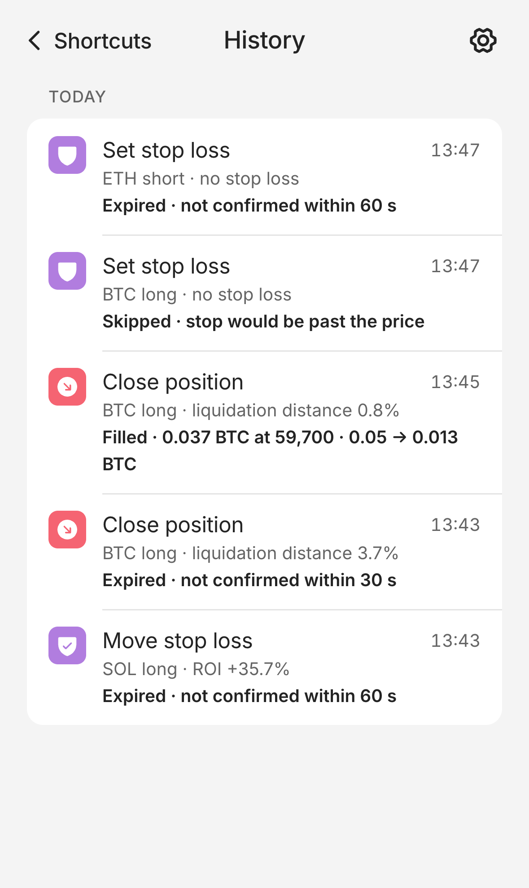

# Trade Shortcuts

Trading alerts and order confirmations for Even Realities G2 smart glasses. Set a rule on your phone, then see what triggered it and review the proposed order on the glasses.

**[Try the browser demo](https://trade-shortcuts-pi.vercel.app/sandbox/#liquidation)** · [Try on your G2](docs/judge-testing.md) · [Project site](https://trade-shortcuts-pi.vercel.app/)

## Features

- Build shortcuts from templates or combine conditions and actions in the phone editor.
- Check prices, PnL and distance to liquidation for open positions on G2.
- Get alerts for market moves or position risk. Review the exact order quantity or price before confirming.
- See fills on G2 and find filled, expired and skipped proposals in phone History.
- With voice answers enabled, say “no” to dismiss. A “yes” confirms an eligible proposal after a five-second cancellation window.

## Screenshots

<table>
  <tr>
    <th>Shortcuts on the phone</th>
    <th>Alert and fill on G2</th>
  </tr>
  <tr>
    <td align="center"></td>
    <td align="center">
      <br>
      
    </td>
  </tr>
</table>

Paper trade shown in the Even Hub Simulator. [27-second simulator clip](assets/demo.mp4) · [BTC position detail on the simulated lens](assets/lens-detail.jpg)

<table>
  <tr>
    <th>Templates</th>
    <th>Rule editor</th>
    <th>History</th>
  </tr>
  <tr>
    <td align="center"><a href="site/landing/img/app/templates.jpg"></a></td>
    <td align="center"><a href="assets/phone-editor.png"></a></td>
    <td align="center"><a href="assets/phone-history.png"></a></td>
  </tr>
</table>

## Try the paper trade

1. Open the [liquidation demo](https://trade-shortcuts-pi.vercel.app/sandbox/#liquidation) and press **▶ Play** below the glasses, or drag the BTC chart down.
2. When the alert appears, press **Down** to select **Close 50%**, then **Click** to confirm.
3. The lens shows **Closed 0.025 BTC**. Select **Start over** to reset the paper position.

The sandbox runs in the browser with simulated positions. Use the [desktop simulator](#run-the-demo) to see the fill in phone History.

## How it works

```text
[Even G2] <--BLE--> [Even app webview / phone UI] <--HTTP API--> [Rule server]
                                                                    |
                                               [Bybit V5 Demo/Testnet or paper exchange]
```

The server polls for prices and positions and evaluates each shortcut's conditions. An order proposal shows the trigger and the proposed action on the glasses with **Dismiss** selected. The server rechecks the proposal before submitting a confirmed order, deduplicates repeated confirmations and records the result in History.

The Bybit adapter supports Demo Trading and Testnet only. Exchange credentials stay on the server. Trade Shortcuts holds no user funds. Test alerts simulate the outcome without changing the account. [Server architecture](docs/shortcuts-architecture.md)

| Entry point | Role |
| --- | --- |
| [`app/src/main.ts`](app/src/main.ts) | Boots the phone UI and the Even Hub glasses integration |
| [`server/src/main.ts`](server/src/main.ts) | Starts the HTTP API, exchange polling and rule evaluation |
| [`server/src/registry.ts`](server/src/registry.ts) and [`server/src/validate.ts`](server/src/validate.ts) | Define the shared shortcut catalog and validation rules |
| [`site/sandbox/`](site/sandbox/) | Browser demo with a simulated lens and paper account |

## Glasses controls

| Input | Positions | Alert |
| --- | --- | --- |
| Swipe | Move between positions | Select **Dismiss** or the proposed action |
| Tap | Open details. Tap again to bring up a close proposal. | Choose the selected option |
| Double tap | Return from position details to the list | Dismiss the alert |

With voice enabled, choose **Speak** and say “close” or “закрой” to bring up a proposal for the position in focus. Opening a position with pending size or leverage choices requires manual selection. [Glasses screens and gestures](docs/glasses-shortcuts.md) · [G2 interface design](docs/design.md)

## Setup

### Run the demo

Install [Node.js 22.18 or newer](https://nodejs.org/) and Git on a machine with a desktop session. Leave ports 5173, 8788 and 9898 free.

```sh
git clone https://github.com/AstralEX1/trade-shortcuts.git
cd trade-shortcuts
npm run demo
```

The runner installs the locked dependencies and opens the phone page and the Even Hub Simulator's **Glasses Display** with a fresh BTC, ETH and SOL paper account. No Bybit account, API keys or glasses are required.

1. Wait about 30 seconds for the BTC **Near liquidation · half** alert. It stays open for two minutes and can return while the condition holds.
2. Press **Down** to select **Close 50%**, then **Click** to confirm.
3. Check the fill on the lens and open **History** with the clock icon on the phone page.

To reset the paper account, stop with Ctrl+C and run `npm run demo` again.

### Run on glasses

The [G2 testing guide](docs/judge-testing.md) covers Even Hub Beta and local QR preview. See the [setup guide](docs/setup.md) for a persistent server, optional integrations and packaging an installable `.ehpk`.

### Development checks

```sh
npm ci
npm run typecheck
npm test
npm run build
npm run build:site
```

## Tech stack

- **Glasses** use the Even Hub SDK and Pretext for text measurement.
- **Phone and browser** use TypeScript and Vite. The phone UI uses [Inter](app/public/licenses/Inter.txt) and [Phosphor Icons](app/public/licenses/Phosphor.txt).
- **Server** uses Node.js, SQLite and Bybit V5. The browser sandbox uses sql.js.
- **Voice answers** use optional OpenAI transcription.

## Heads Up Hackathon

Trade Shortcuts was built for the Exchanges & Stocks track. [DoraHacks submission brief](docs/dorahacks.md)

| Environment | Evidence |
| --- | --- |
| Browser sandbox and Even Hub Simulator | BTC paper alert, confirmation and fill. The simulator run recorded the fill in phone History. |
| Bybit Testnet | Tested a position open, reduce-only close, stop and take-profit updates, and a limit-order cancellation on XRPUSDT. |
| Physical Even G2 and R1 | Device verification pending. |

[Test and release evidence](docs/handoff.md)

### What existed before November 23, 2026

No Trade Shortcuts application code existed before kickoff. The [first project commit](https://github.com/AstralEX1/trade-shortcuts/commit/5aee0bd) is dated November 24. The phone editor, rule engine, paper exchange, Bybit V5 integration, trade confirmation flow and G2 screens were built during the hackathon.

The project uses the existing Even Hub SDK, simulator and CLI. The PNG and wear-state helpers are adapted from [Market Glimpse](https://github.com/adamtorgerson/market-glimpse) with the author's permission. The simulator capture workflow also draws on that project. Its repository does not list a project license.

### API feature requests

- **Even Hub SDK** should report when a page or image has rendered on the glasses so rapid updates can be paced without fixed delays.
- **Bybit V5** should return the ROI shown in the Bybit app, including after isolated margin changes.
- **Bybit V5** should accept a client request ID and provide a status lookup for isolated-margin adjustments so the app can safely reconcile timed-out writes.

## License

[MIT](LICENSE) · [Privacy policy](https://trade-shortcuts-pi.vercel.app/privacy.html) · [Even Hub store assets and QA](docs/store-listing.md)
