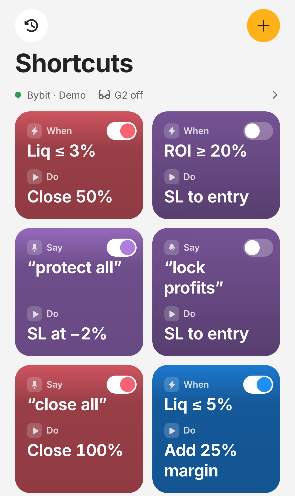
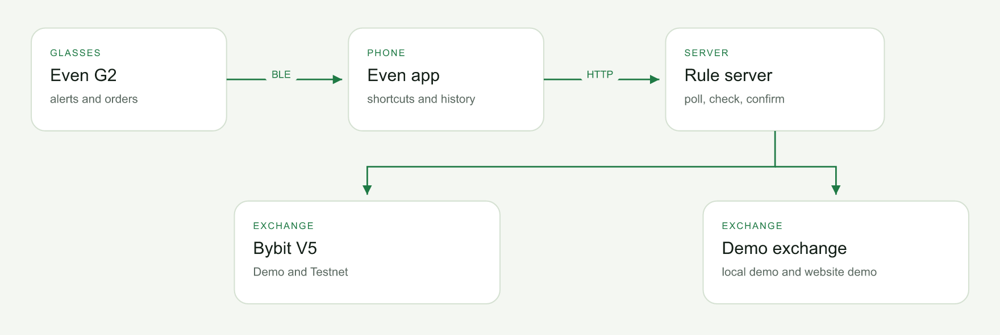

# Trade Shortcuts

Trading alerts and order confirmations for [Even Realities G2](https://www.evenrealities.com/) smart glasses.

Set a shortcut on your phone. The glasses show what triggered it, and the exact order, before anything is sent.

**[Phone app](https://tradeshortcuts.xyz/phone/)** · **[Website demo](https://tradeshortcuts.xyz/sandbox/#liquidation)** · **[Watch the project pitch](https://x.com/AstralEX163/status/2126603447172841705)** · [Try on your G2](docs/judge-testing.md) · [Project site](https://tradeshortcuts.xyz/)

The hosted phone page connects to the paper server with the address and token shared privately.

## Features

- Build shortcuts from templates, or combine conditions and actions in the phone editor.
- Check price, PnL and distance to liquidation for open positions.
- Get an alert for a market move or position risk. Review the quantity or price before confirming.
- See fills on the glasses. Filled, expired and skipped proposals stay in phone History.
- With voice on, say “no” to dismiss. “Yes” confirms after a five-second cancel window.

## Screenshots

<table>
  <tr>
    <th>Shortcuts on the phone</th>
    <th>Alert and fill on G2</th>
  </tr>
  <tr>
    <td align="center"></td>
    <td align="center">
      <br>
      
    </td>
  </tr>
</table>

Lens frames are from the Even Hub Simulator. [27-second clip](assets/demo.mp4) · [BTC position on the lens](assets/lens-detail.jpg)

<table>
  <tr>
    <th>Templates</th>
    <th>Rule editor</th>
    <th>History</th>
  </tr>
  <tr>
    <td align="center"><a href="site/landing/img/app/templates.jpg"></a></td>
    <td align="center"><a href="assets/phone-editor.png"></a></td>
    <td align="center"><a href="assets/phone-history.png"></a></td>
  </tr>
</table>

## Website demo

1. Open the [demo](https://tradeshortcuts.xyz/sandbox/#liquidation) and press **Play** under the glasses, or drag the BTC chart down.
2. When the alert appears, press **Down** to select **Close 50%**, then **Click**.
3. The lens shows **Closed 0.025 BTC**. **Start over** resets the demo.

Runs in the browser. No account and no install. The [local demo](#demo) also writes the fill into phone History.

## Architecture

The phone and the glasses talk to one rule server. It polls prices and positions, then checks each shortcut.



Exchange keys stay on the server. The app holds no funds. Bybit is Demo and Testnet only.

```
app/src/
  main.ts           Glasses bridge and phone boot
  api.ts            Rule server client
  view.ts           Lens screens
  phone/            Shortcut list, editor, history, settings

server/src/
  main.ts           API, polling, exchange choice
  http.ts           HTTP routes
  session.ts        Poll, evaluate, confirm
  engine.ts         Condition checks
  registry.ts       Shortcut catalog
  validate.ts       Rule checks
  proposals.ts      Exact order for one trigger
  execute.ts        Send a confirmed order
  bybit.ts          Bybit V5 Demo and Testnet
  fake-exchange.ts  Built-in demo exchange
  store.ts          SQLite alerts and history
  notify.ts         Deliver alerts to open clients
  stt.ts            Optional voice transcription

site/sandbox/src/
  page.ts           Website demo
  backend.ts        Same server, in the browser
  exchange.ts       Demo prices and positions
  lens.ts           Simulated G2 display
  scenarios.ts      Playable scenarios
```

A proposal opens on the glasses with **Dismiss** selected. The server checks it again before sending the order, ignores a repeated confirm, and stores the result in History.

## Controls

| Input | Positions | Alert |
| --- | --- | --- |
| Swipe | Move between positions | Select **Dismiss** or the proposed action |
| Tap | Open details. Tap again for a close proposal | Choose the selected option |
| Double tap | Back to the list | Dismiss the alert |

With voice on, choose **Speak** and say “close” or “закрой” for the position in focus. Opening a position that still needs a size or leverage is manual. [Glasses screens](docs/glasses-shortcuts.md) · [Interface notes](docs/design.md)

## Setup

[Node.js 22.18 or newer](https://nodejs.org/) and Git.

### Demo

```bash
git clone https://github.com/AstralEX1/trade-shortcuts.git
cd trade-shortcuts
npm run demo
```

Wait for the BTC **Near liquidation · half** alert, then confirm **Close 50%** the same way as the [website demo](#website-demo). The fill shows on the lens and in phone History.

Ctrl+C stops it. Run `npm run demo` again for a fresh demo.

### On a G2

The [testing guide](docs/judge-testing.md) covers Even Hub Beta and a local QR. The [setup guide](docs/setup.md) covers a persistent server and an installable `.ehpk`.

### Checks

```bash
npm ci
npm run typecheck
npm test
npm run build
npm run build:site
```

## Tech stack

- [@evenrealities/even_hub_sdk](https://www.npmjs.com/package/@evenrealities/even_hub_sdk)
- [@evenrealities/evenhub-simulator](https://www.npmjs.com/package/@evenrealities/evenhub-simulator)
- [TypeScript](https://www.typescriptlang.org/) + [Vite](https://vitejs.dev/)
- [Node.js](https://nodejs.org/)
- [OpenAI](https://platform.openai.com/docs/guides/speech-to-text)
- [React](https://react.dev/) + [Base UI](https://base-ui.com/)

## Heads Up Hackathon

Built for the Exchanges & Stocks track. [Submission brief](docs/dorahacks.md)

| Where | What was checked |
| --- | --- |
| Website demo and Even Hub Simulator | BTC alert, confirm, fill, and History |
| Bybit Testnet | Open, reduce-only close, stop, take-profit, and a limit cancel on XRPUSDT |
| Physical G2 and R1 | Not checked on a device yet |

[Test notes](docs/handoff.md)

### API requests

- **Even Hub SDK** should report when a page has rendered, so updates are not paced with fixed delays.
- **Bybit V5** should return the ROI shown in the Bybit app, including after an isolated-margin change.
- **Bybit V5** should accept a client request id for an isolated-margin change, and a way to look up the result.

## License

[MIT](LICENSE) · [Privacy policy](https://tradeshortcuts.xyz/privacy.html) · [Even Hub listing](docs/store-listing.md)
