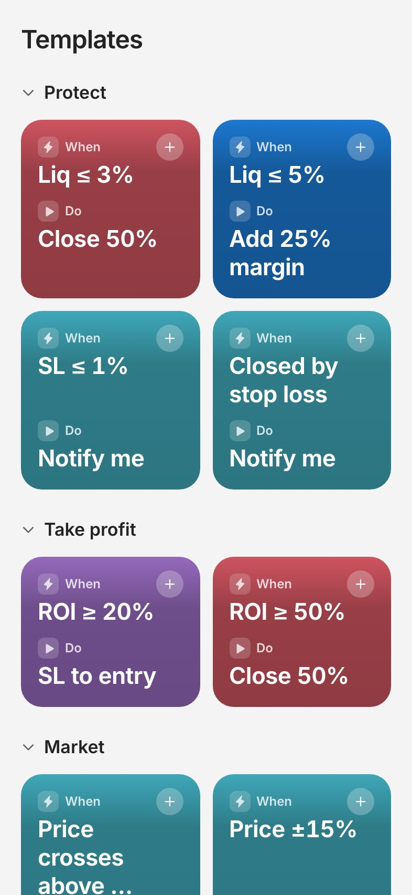
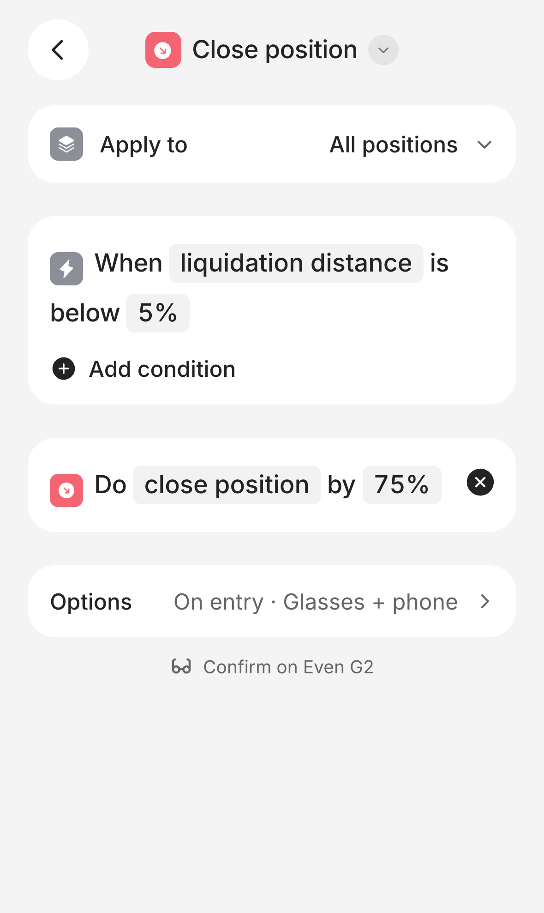
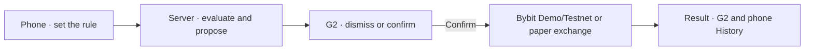

<div align="center">
  
  <h1>Trade Shortcuts</h1>
  <p><strong>Set a trading rule on your phone. Review and confirm it on your Even G2.</strong></p>
  <p>Heads Up Hackathon · Exchanges &amp; Stocks</p>
  <p>
    <a href="https://trade-shortcuts-pi.vercel.app/sandbox/#liquidation"><strong>Try the interactive demo</strong></a> ·
    <a href="docs/judge-testing.md">Try on your G2</a> ·
    <a href="#run-the-demo">Run in Even Hub Simulator</a>
  </p>
</div>

A Bybit trader can miss a position nearing liquidation while their phone is in their pocket. Trade Shortcuts shows the risk and the proposed order size on the glasses, then lets the trader choose whether to act.

<table>
  <tr>
    <th>Set the rule on your phone</th>
    <th>Review and confirm on G2</th>
  </tr>
  <tr>
    <td align="center"></td>
    <td align="center">
      <br>
      
    </td>
  </tr>
</table>

Paper trade shown on the Even Hub Simulator. [27-second simulator clip](assets/demo.mp4)

## Try the paper trade

1. Open the [Liquidation demo](https://trade-shortcuts-pi.vercel.app/sandbox/#liquidation) and press **▶ Play** under the glasses, or drag the BTC chart down.
2. When the BTC alert appears, use **Down** to select **Close 50%**, then **Click** to confirm.
3. The lens reports **Closed 0.025 BTC**. Use **Start over** to start with a fresh position.

The sandbox runs with simulated positions and requires only a browser. For the actual phone app and paired glasses, follow the [G2 testing guide](docs/judge-testing.md). The desktop simulator below also shows the trade in phone History.

## More app screens

<table>
  <tr>
    <th>Pick a template</th>
    <th>Edit a rule</th>
    <th>Review outcomes</th>
  </tr>
  <tr>
    <td align="center"><a href="site/landing/img/app/templates.jpg"></a></td>
    <td align="center"><a href="assets/phone-editor.png"></a></td>
    <td align="center"><a href="assets/phone-history.png"></a></td>
  </tr>
</table>

[BTC position detail on the simulated lens](assets/lens-detail.jpg)

## Run the demo

Install [Node.js 22.18 or newer](https://nodejs.org/) and Git on a machine with a desktop session.

```sh
git clone https://github.com/AstralEX1/trade-shortcuts.git
cd trade-shortcuts
npm run demo
```

The runner installs the locked dependencies and opens the phone page and the Even Hub Simulator's **Glasses Display**. It starts a fresh paper account with BTC, ETH, and SOL positions. It requires free local ports 5173, 8788, and 9898. No account, API keys, or glasses are required.

1. Wait for the BTC **Near liquidation · half** alert in **Glasses Display**. It appears about 30 seconds after startup and stays open for two minutes. If missed, it returns while the condition still holds.
2. Press **Down**. When the cursor reaches **Close 50%**, press **Click** to confirm.
3. Check the fill on the lens and open **History** on the phone page using the clock icon.

To start over with the original 0.050 BTC position, stop with Ctrl+C and run `npm run demo` again. For a persistent server, optional integrations, QR preview, or an installable `.ehpk`, see the [setup guide](docs/setup.md).

## How it works



- **Read:** the server polls Bybit V5 for positions and evaluates your conditions. The G2 alert shows why the rule fired and the exact quantity or price proposed.
- **Write:** the lens starts on **Dismiss**. Swipe to the proposed action and tap. The server checks the proposed terms again, deduplicates repeated taps and records the outcome in SQLite.
- **Voice:** with transcription configured and voice answers enabled, a spoken “no” dismisses an alert. A spoken “yes” can confirm an eligible proposal after a five-second cancellation window. On the position list or a position, Speak then “close” or “закрой” raises a close card for the position in focus. A tap on that position screen does the same. The card still starts on Dismiss.

The Bybit adapter accepts **Demo Trading and Testnet only**. Exchange credentials stay on the server. Trade Shortcuts holds no user funds. Test alerts simulate the outcome without changing the account.

## What we verified

| Environment | Evidence |
| --- | --- |
| Browser sandbox and Even Hub Simulator | Paper BTC alert, confirmation and fill. The simulator run recorded the fill in phone History. |
| Bybit Testnet | Position open, reduce-only close, stop and take-profit updates, and limit-order cancellation exercised on XRPUSDT. |
| Physical Even G2 and R1 | Device verification pending. |

[Test and release evidence](docs/handoff.md) · [Server architecture](docs/shortcuts-architecture.md) · [G2 interface design](docs/design.md)

## What existed before November 23, 2026

No Trade Shortcuts application code existed before kickoff. The [first project commit](https://github.com/AstralEX1/trade-shortcuts/commit/5aee0bd) is dated November 24. The phone editor, rule engine, paper exchange, Bybit V5 integration, trade confirmation flow, and G2 screens were built during the hackathon.

The project uses the existing Even Hub SDK, simulator, and CLI, plus Pretext, Bybit V5, TypeScript, Vite, Node.js, SQLite, and sql.js. Voice answers use OpenAI transcription. The PNG and wear-state helpers are adapted from [Market Glimpse](https://github.com/adamtorgerson/market-glimpse) with the author's permission. The simulator capture workflow also draws on that project. Its repository does not list a project license. The phone UI uses [Inter](app/public/licenses/Inter.txt) and [Phosphor Icons](app/public/licenses/Phosphor.txt).

## API feature requests

- **Even Hub SDK:** report when a page or image has actually rendered on the glasses so rapid updates can be paced without fixed delays.
- **Bybit V5:** return the same ROI value displayed in the Bybit app, including after isolated margin changes.
- **Bybit V5:** provide a client request ID and status lookup for isolated-margin adjustments, so a timed-out write can be reconciled safely.

[DoraHacks submission brief](docs/dorahacks.md) · [Project site](https://trade-shortcuts-pi.vercel.app/)

## Development checks

```sh
npm ci
npm run typecheck
npm test
npm run build
npm run build:site
```

## License

[MIT](LICENSE) · [Privacy policy](https://trade-shortcuts-pi.vercel.app/privacy.html) · [Even Hub store assets and QA](docs/store-listing.md)
