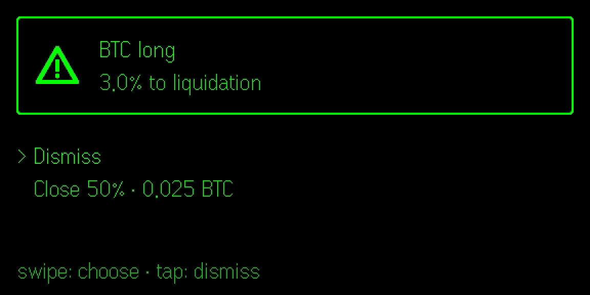
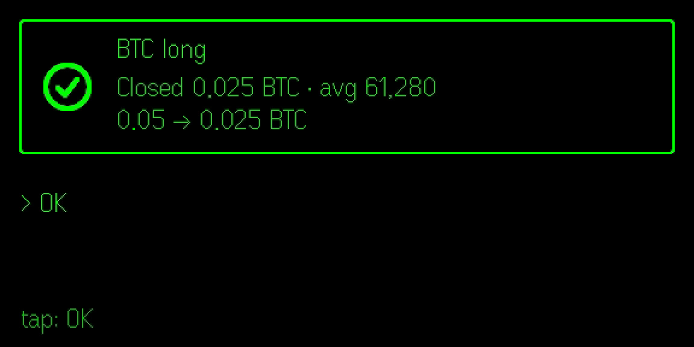

<div align="center">
  
  <h1>Trade Shortcuts</h1>
  <p><strong>Bybit position alerts and trade confirmations on Even Realities G2.</strong></p>
  <p>Heads Up Hackathon · Exchanges &amp; Stocks</p>
  <p>
    <a href="https://trade-shortcuts-pi.vercel.app/sandbox/"><strong>Try the sandbox</strong></a> ·
    <a href="assets/demo.mp4">Watch the 27-second demo</a> ·
    <a href="#run-the-demo">Run in Even Hub Simulator</a> ·
    <a href="docs/dorahacks.md">DoraHacks entry</a>
  </p>
</div>

A trader away from their phone can miss a Bybit position approaching liquidation. Trade Shortcuts puts the alert, the proposed order size, and the exchange result in their field of view.

<table>
  <tr>
    <th>Set the rule on your phone</th>
    <th>Review and confirm on G2</th>
  </tr>
  <tr>
    <td align="center"></td>
    <td align="center">
      <br>
      
    </td>
  </tr>
</table>

The video shows four stages of one paper trade captured in the Even Hub Simulator. [Position detail](assets/lens-detail.jpg) · [Rule editor](assets/phone-editor.png) · [History](assets/phone-history.png) · [Project site](https://trade-shortcuts-pi.vercel.app/)

## Try it in your browser

Open the [paper sandbox](https://trade-shortcuts-pi.vercel.app/sandbox/), choose **BTC +10%**, **Liquidation**, or **Lock profit**, and press ▶ beside the phone. In **Liquidation**, select **Close 50%** on the simulated lens and tap to confirm. In **Free sandbox**, you can move the BTC price and use all three screens together.

Both demos use simulated positions. You only need a browser for the sandbox.

## Run the demo

Install [Node.js 22.18 or newer](https://nodejs.org/) and Git on a machine with a desktop session.

```sh
git clone https://github.com/AstralEX1/trade-shortcuts.git
cd trade-shortcuts
npm run demo
```

The runner installs the locked dependencies and opens the phone page and the Even Hub Simulator's **Glasses Display**. It starts a fresh paper account with BTC, ETH, and SOL positions. It requires free local ports 5173, 8788, and 9898. No account, API keys, or glasses are required.

1. Wait for the BTC **Near liquidation · half** alert in **Glasses Display**. It appears about 30 seconds after startup and stays open for two minutes. If missed, it returns while the condition still holds.
2. Press **Down**. When the cursor reaches **Close 50%**, press **Click** to confirm.
3. Check the fill on the lens and open **History** on the phone page using the clock icon.

To start over with the original 0.050 BTC position, stop with Ctrl+C and run `npm run demo` again. For a persistent server, optional integrations, QR preview, or an installable `.ehpk`, see the [setup guide](docs/setup.md).

## How it works

- **Phone:** choose a scope, set the **When** conditions, and pick one **Do** action. Start with one of 12 templates or write a rule from scratch.
- **Glasses:** read open positions and ROI at a glance. An alert shows what triggered the rule and the proposed quantity or price. Swipe from **Dismiss** to the action, then tap to confirm.
- **Backend:** a TypeScript server polls Bybit V5, evaluates rules, and records proposals and their execution in SQLite. Confirmation rechecks the terms and deduplicates repeated taps. The lens and History show the resulting status.
- **Optional:** With voice answers enabled, a spoken “no” dismisses an alert and a spoken “yes” can confirm an eligible proposal after a five-second cancellation window.

The Bybit adapter accepts **Demo Trading and Testnet only**. Exchange credentials stay on the server. Trade Shortcuts holds no user funds. Test alerts run entirely in simulation. Physical G2 and R1 verification is pending. [Technical architecture](docs/shortcuts-architecture.md) · [G2 design](docs/design.md) · [Test coverage and device status](docs/handoff.md)

## What existed before November 23, 2026

No Trade Shortcuts application code existed before kickoff. The [first project commit](https://github.com/AstralEX1/trade-shortcuts/commit/5aee0bd) is dated November 24. The phone editor, rule engine, paper exchange, Bybit V5 integration, trade confirmation flow, and G2 screens were built during the hackathon.

The project uses the existing Even Hub SDK, simulator, and CLI, plus Pretext, Bybit V5, TypeScript, Vite, Node.js, SQLite, and sql.js. Voice answers use OpenAI transcription. The PNG and wear-state helpers are adapted from [Market Glimpse](https://github.com/adamtorgerson/market-glimpse) with the author's permission. The simulator capture workflow also draws on that project. Its repository does not list a project license. The phone UI uses [Inter](app/public/licenses/Inter.txt) and [Phosphor Icons](app/public/licenses/Phosphor.txt).

## API feature requests

- **Even Hub SDK:** report when a page or image has actually rendered on the glasses so rapid updates can be paced without fixed delays.
- **Bybit V5:** return the same ROI value displayed in the Bybit app, including after isolated margin changes.
- **Bybit V5:** provide a client request ID and status lookup for isolated-margin adjustments, so a timed-out write can be reconciled safely.

## Development checks

```sh
npm ci
npm run typecheck
npm test
npm run build
npm run build:site
```
