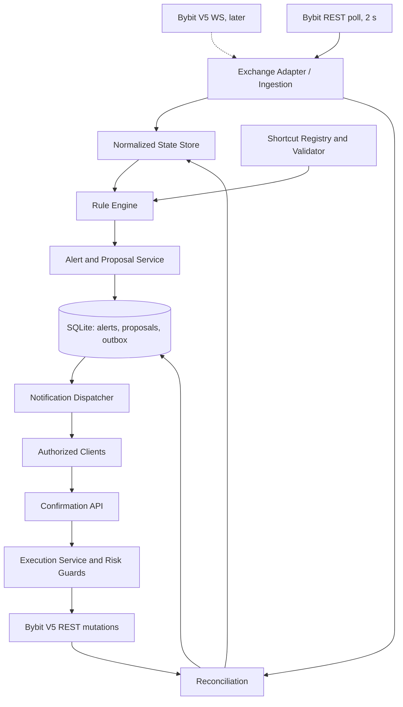

# Bybit Shortcuts — Technical Architecture

**MVP / implementation brief** · 24 November 2026 · revised against the UI and the Sightline code

Architecture and domain logic only. This document supersedes the architectural sections of the earlier UI/UX specification (`bybit-shortcuts-spec.md`).

The UI is fixed and this brief serves it:
- phone: design canvas "Bybit Shortcuts × Even G2" (https://claude.ai/artifact/QkfLzCX64QKfdKRV6N2BUA): Shortcuts, New Shortcut, Shortcut Editor, token menu, numeric sheet, Close amount, Apply to, Incompatible, History, Settings;
- lens: `docs/glasses-shortcuts.md` and its canvas (https://claude.ai/artifact/1n89NY12383wwVqdkFS1Pr). Where the phone canvas's own G2 boards differ from it (countdown bar, `Confirm` preselected), `glasses-shortcuts.md` wins.

Build on the existing Sightline server (`server/src`): its rules engine, session, Bybit client, fake exchange and tests already cover part of this brief (§13 lists what to keep). Section 15 records the product decisions and the UI changes they need.

## 1. Product contract

- One shortcut = one scope + one or more conditions + exactly one action with one parameter set.
- Conditions use one group operator (`ALL` / AND or `ANY` / OR). No nesting, mixed precedence, action lists, chains, or arbitrary executable user code.
- Rules generate alerts and action proposals, not automatic trades. Every exchange mutation requires explicit authorization of the exact resolved proposal. `NOTIFY` requires no trade confirmation.
- A shortcut may also carry a voice phrase. Saying it on the glasses raises that shortcut's proposals at once, for every target in its scope whose action guards pass; conditions are not checked, the phrase is the trigger. Each proposal still needs its own tap.
- Support Bybit USDT-settled linear perpetuals only. Demo/mock first; no implicit live mode, withdrawals, other exchanges, spot, options, inverse or portfolio-margin trading.
- Market alerts work without a position; global position rules evaluate each live position separately. No portfolio-wide or cross-symbol joins.
- Multiple shortcuts may trigger together; group delivery where appropriate but keep each proposal independent. Never execute an entire group.

## 2. Architecture and references

Use an event-driven **modular monolith**, not a distributed microservice system. The backend is the authoritative state owner; mobile and Even Hub integrations are replaceable clients.



Reference-driven decisions:

| Reference | Adopt | Do not copy |
|---|---|---|
| Bybit V5 [1–7] | WebSocket events, REST bootstrap/reconciliation, instrument constraints, async order confirmation | Treating a REST acknowledgement as a completed trade |
| TradingView alerts [8] | Explicit crossing vs level predicates, alert frequency and rearming | Full technical indicator engine |
| Coinrule [9] | Condition/action separation and reusable rule definitions | Automatic trade execution |
| json-rules-engine / JsonLogic [10–11] | Declarative `all/any` conditions and evaluation over facts | Arbitrary scripts or generic rule engine as a trading safety layer |
| Azure event-driven architecture [12] | Event producers, consumers, independent responsibilities, idempotency | Separate deployable service per module |
| AWS transactional outbox [13] | Atomic persistence of alerts and delivery intent, at-least-once delivery | Kafka, external broker and complex event sourcing in the MVP |

Stack: the existing one. TypeScript run directly by Node ≥ 22.18, no HTTP framework (`server/src/http.ts`), the signed REST client in `server/src/bybit.ts`, REST polling every 2 s (`server/src/main.ts`). One process, one account. Deploy on a persistent host; a request-only serverless function must not own the polling loop or exchange WebSockets. Do not require Redis, Kafka, Kubernetes, PostgreSQL or an LLM.

| Need | MVP choice | Upgrade when |
|---|---|---|
| Durable alerts, proposals, outbox | built-in `node:sqlite` (no flag on Node 22.13+, prints an ExperimentalWarning), one file, transactions | several workers or accounts: PostgreSQL with the same tables |
| Mutation serialization | in-process promise chain per account/symbol/positionIdx | several workers: row or advisory locks |
| Private state | REST polling 2 s, fills deduped by `execId` (already done) | fills or crossings arrive too late: private WS via `bybit-api` (`sieblyio/bybit-api`, MIT) `WebsocketClient` only, which handles auth, heartbeats, the 24 h disconnect and resubscribe; keep our REST client |
| Public prices | `/v5/market/tickers` per watched symbol in the same poll | many symbols: public `tickers.{symbol}` WS (Node 22 has a global `WebSocket`) |
| Runtime schemas | hand validation as in `server/src/config.ts` | the tagged unions get unwieldy: Zod |
| Money arithmetic | numbers for comparisons; exchange steps kept as strings and quantized by `toStep` (already done); persisted thresholds are decimal strings | a rounding bug shows: decimal.js |
| Alerts on the phone | in-app notifications in the phone app while it is open (it already polls the server); Telegram Bot API `sendMessage` for everything else. Text only, never a confirm button or link. The bot reads `/start <code>` with `getUpdates` long polling, so no webhook and no public URL. Even Hub SDK 0.0.16 has no push to the phone (only bridge events), so a closed app gets nothing else | the phone app becomes native: OS push |
| Speech to text | `server/src/stt.ts` and `POST /api/voice` as today (OpenAI, only when its key is set) | — |

Not reused on purpose: json-rules-engine, JsonLogic, GoRules (no UNKNOWN / NOT_APPLICABLE; the evaluator is a few dozen lines).

## 3. Major modules

| Block | Responsibility | Boundary |
|---|---|---|
| Shortcut Registry | Typed catalog of conditions, actions, scopes, templates, versioned rules | No exchange writes |
| Compatibility Validator | Static matrices, parameter checks, logical consistency, capability constraints | Same implementation for create/update/enable |
| Exchange Adapter | Authentication, WS subscriptions, REST queries and commands, normalization, rate limits | Only module speaking Bybit wire format |
| State Store | Latest quotes, positions, orders, balance, instruments, rolling windows; freshness and identity | No alert or trade side effects |
| Rule Engine | Resolve targets, select affected rules, evaluate predicates and trigger policy | Pure evaluation + persisted trigger state; never sends orders |
| Alert/Proposal Service | Build one resolved proposal per match, dedupe, expiry, group delivery, priority | Proposals are immutable authorization objects |
| Delivery Adapter | Deliver durable alerts to connected clients, acknowledge, replay and fallback | Never grants execution authority |
| Execution Service | Authorize exact proposal, revalidate, serialize, submit, reconcile, audit | Only module allowed to mutate exchange state through adapter |

Layout: keep `server/src` flat, one file per block, next to the files that exist: `registry.ts` (catalog, matrices, templates as data), `validate.ts`, `engine.ts` (evaluator and trigger policy; replaces the built-in rules in `rules.ts`), `proposals.ts`, `execute.ts`, `store.ts` (SQLite), `notify.ts`; `bybit.ts` and `fake-exchange.ts` grow the new calls; `session.ts` keeps the tick loop and the lens state. Tests stay in `server/test`. The `Exchange` interface keeps its deterministic `FakeExchange`.

## 4. Canonical rule model

This is the one schema the phone app, the server and the tests share. The old `Shortcut` type in `server/src/types.ts` (a voice phrase → stop/lock/buy/sell) goes away: its phrases become `voicePhrase` on shortcuts made from templates (§12).

```ts
type Dec = string; // decimal string, e.g. "30", "0.5"

interface Shortcut {
  schemaVersion: 1;
  id: string;
  accountId: string;
  version: number;              // a new immutable version on every edit
  enabled: boolean;             // the switch on the Shortcuts tile
  name?: string;                // editor header "rename"; default title = the action label, e.g. "Move Stop Loss"
  scope: Scope;                 // editor "Apply to"
  conditions: { logic: 'ALL' | 'ANY'; items: Condition[] }; // 1–10 items; 0 only with a voicePhrase (voice-only)
  voicePhrase?: string;         // editor Options; up to 40 lowercase letters, digits, spaces; unique per account
  action: Action;               // NOT an array
  trigger: { mode: 'ON_ENTRY' | 'ON_EVENT' | 'ONCE' | 'REPEAT'; intervalSec?: number }; // editor Options
  delivery: { glasses: boolean; phone: boolean };          // editor Options: "Glasses + phone"
}

type Scope =
  | { type: 'ALL_POSITIONS' }                                          // "All positions · 3 now"
  | { type: 'POSITION'; symbol: string; positionIdx: 0 | 1 | 2; epoch: string } // "One position"
  | { type: 'SYMBOL'; symbol: string }                                 // "One symbol"
  | { type: 'ORDER'; symbol: string; orderId: string };                // "One order"

// Every item has a stable id: the editor removes and flags single rows, validate() points at them,
// and an alert records which ones matched.
type Condition = { id: string } & (
  | { type: 'PRICE'; source: 'LAST' | 'MARK' | 'INDEX'; operator: 'GTE' | 'LTE' | 'UP_CROSS' | 'DOWN_CROSS'; threshold: Dec }
  | { type: 'PRICE_CHANGE'; source: 'LAST' | 'MARK' | 'INDEX'; direction: 'UP' | 'DOWN'; percent: Dec; windowSec: number }
  | { type: 'PROFIT' | 'LOSS'; unit: 'USDT' | 'ROI_PERCENT'; threshold: Dec } // positive magnitude
  | { type: 'NEAR_LIQUIDATION' | 'NEAR_SL' | 'NEAR_TP'; distancePct: Dec }
  | { type: 'SL_MISSING' | 'ORDER_FILLED' | 'ORDER_PARTIAL' });

// One convention for every stop and target: percent > 0 is the favorable side of entry for this position, < 0 adverse, 0 = entry.
type Target = { kind: 'ENTRY_OFFSET'; percent: Dec } | { kind: 'PRICE'; price: Dec }; // PRICE only for one-symbol scopes

type Action =
  | { type: 'CLOSE_POSITION'; percent: Dec }                 // Close amount: 25 / 50 / 75 / 100 / custom
  | { type: 'MOVE_SL' | 'SET_SL' | 'SET_TP'; target: Target }
  | { type: 'ADD_MARGIN'; usdt: Dec }
  | { type: 'OPEN_POSITION'; side: 'LONG' | 'SHORT'; notionalUsdt: Dec; leverage: Dec; sl?: Target; tp?: Target } // symbol from scope
  | { type: 'INCREASE_POSITION'; notionalUsdt: Dec }
  | { type: 'CANCEL_ORDER' }                                 // the scope's order
  | { type: 'NOTIFY' };
```

Validated tagged unions, not free-form strings. Timestamps are UTC. Labels and the sentence are derived from types, never parsed to execute logic. Priority is derived, not edited: `CRITICAL` when any condition is `NEAR_LIQUIDATION`, `LOSS`, `NEAR_SL` or `SL_MISSING`. Environment (demo or mock) belongs to the account, not the shortcut.

How the editor's sentence maps to the schema:

| Editor words | Schema |
|---|---|
| `price` `is above` / `is below` / `crosses above` / `crosses below` N | `PRICE` `GTE` / `LTE` / `UP_CROSS` / `DOWN_CROSS` |
| `price change` `rises` / `falls` by N% within T min | `PRICE_CHANGE` `UP` / `DOWN`, `windowSec = 60·T` |
| `ROI` `is above` N% · `ROI` `is below` −N% | `PROFIT` / `LOSS`, `ROI_PERCENT`, threshold N |
| `profit is above` N USDT · `loss is above` N USDT | `PROFIT` / `LOSS`, `USDT` |
| `liquidation distance` / `stop loss distance` / `take profit distance` `is below` N% | `NEAR_LIQUIDATION` / `NEAR_SL` / `NEAR_TP` |
| `stop loss is missing` · `order is filled` · `order is partly filled` | `SL_MISSING` · `ORDER_FILLED` · `ORDER_PARTIAL` |
| `and` / `or` token before the second row | `logic` `ALL` / `ANY` |
| `move stop loss to entry price` | `MOVE_SL`, `{kind: 'ENTRY_OFFSET', percent: '0'}` |
| Options `On entry` / `On event` / `Once` / `Repeat` | `trigger.mode` |
| Options `Voice phrase` "protect all" | `voicePhrase` |

Voice: the transcript is matched as today (`matchShortcut` in `rules.ts`: the longest phrase found as whole words). A match builds proposals exactly as a fired rule would, with the alert's reason set to `Voice: <phrase>`; guards and confirmation all apply. A voice-only shortcut (no conditions) is never evaluated by the engine. Its action must still pass the scope rules of §7 (Open needs a symbol scope, Cancel an order scope).

Flipping `above` ↔ `below` on ROI or PnL changes PROFIT ↔ LOSS: the editor asks for a new value instead of carrying the old one over (spec §7.4).

Scopes:
- `SYMBOL`: account + category + symbol; market rules, notify or guarded open.
- `ALL_POSITIONS`: one independent target per eligible open position, including future ones.
- `POSITION`: account + category + symbol + positionIdx + position epoch; distinguishes hedge-mode sides and a reopened position from an old one.
- `ORDER`: exact orderId + account/category/symbol; position actions only through a verified opening-fill mapping. The editor needs an order picker (open orders of the account); templates 14 and 15 stay drafts until one is picked.

Example: the "Close Position · Liq. < 5% or ROI < −20%" tile on the Shortcuts screen.

```json
{
  "schemaVersion": 1,
  "id": "sc_123",
  "accountId": "account_1",
  "version": 1,
  "enabled": true,
  "scope": {"type": "ALL_POSITIONS"},
  "conditions": {"logic": "ANY", "items": [
    {"id": "c1", "type": "NEAR_LIQUIDATION", "distancePct": "5"},
    {"id": "c2", "type": "LOSS", "unit": "ROI_PERCENT", "threshold": "20"}
  ]},
  "action": {"type": "CLOSE_POSITION", "percent": "50"},
  "trigger": {"mode": "ON_ENTRY"},
  "delivery": {"glasses": true, "phone": true}
}
```

Persist immutable rule versions. Edit, pause or delete invalidates outstanding proposals belonging to the old version. An already submitted execution remains in reconciliation.

## 5. Condition blocks (14 variants, 7 families)

| ID | Condition | Parameters | Fact / event |
|---|---|---|---|
| C1 | `PRICE` | source, operator (`GTE/LTE/UP_CROSS/DOWN_CROSS`), threshold | Quote / crossing |
| C2 | `PRICE_CHANGE` | source, direction, percent, windowSec | Rolling price history |
| C3 | `PROFIT` | USDT or ROI %, positive magnitude | Position PnL >= N |
| C4 | `LOSS` | USDT or ROI %, positive magnitude | Position PnL <= -N |
| C5 | `NEAR_LIQUIDATION` | distancePct | Mark price, liquidation price |
| C6 | `NEAR_SL` | distancePct | SL price, actual trigger source |
| C7 | `NEAR_TP` | distancePct | TP price, actual trigger source |
| C8 | `SL_MISSING` | none | Verified protection inventory |
| C9 | `ORDER_FILLED` | scope-bound order | Transition into Filled |
| C10 | `ORDER_PARTIAL` | scope-bound order | First partial fill with remaining quantity |
| C11 | `VOLUME_SPIKE` | multiplier (1,100], windowSec 1–60 min | Last-price 1-minute candles, read once a minute |
| C12 | `FUNDING` | ratePct (0,5], minutesBefore 1–480 | Ticker `fundingRate`, `nextFundingTime` |
| C13 | `ORDER_STALE` | minutes 1–10080 | Open order's `createdTime` |
| C14 | `POSITION_CLOSED` | by: `SL` / `TP` / `LIQUIDATION` | Execution `stopOrderType` (StopLoss, PartialStopLoss, TrailingStop / TakeProfit, PartialTakeProfit) or `execType` BustTrade |

Families: Price (C1–2), PnL (C3–4), Liquidation (C5), TP/SL (C6–8), Orders (C9–10, C13), Market (C11–12), Closes (C14).

### Metric definitions

For side sign `d=+1` long / `-1` short, positive relevant price `P`, entry `E`, base quantity `Q`, liquidation `L`, stop `S`, target `T`:
- Price change = `100 * (P_now / P_window_ago - 1)`; same price source, timestamp-aligned history. Default source LastPrice. No interpolation over an unverified data gap. After a restart, warm the window from 1-minute candles (`/v5/market/kline` for Last, `/v5/market/mark-price-kline` for Mark, `/v5/market/index-price-kline` for Index), so the 5-minute templates are not UNKNOWN for the first 5 minutes; until then the window counts as minute-aligned, not tick-aligned.
- Linear unrealized PnL = `d * Q * (P - E)`; prefer authoritative exchange values where fresh and consistent. Mark-price recalculation may be used when verified against Bybit. No mixing of realized PnL or fees.
- ROI = `100 * unrealizedPnL / applicable Bybit position margin`. Start from `positionIM` in `/v5/position/list` as the denominator and check parity with the Bybit app on Demo for each supported margin mode; if it does not match or is missing, return UNKNOWN and allow USDT PnL instead. Do not substitute price change times leverage as exact ROI. The current Sightline "lock profit" rule uses price move %, not ROI, so template 1 is a new rule, not a rename.
- Liquidation distance = `100 * d * (markPrice - L) / markPrice`. Cross-margin estimate only when valid; portfolio-margin liquidation conditions unsupported. An empty liquidation price from Bybit (cross margin far from liquidation) is a known absence, NOT_APPLICABLE, as Sightline treats it today; a stale or unread position is UNKNOWN.
- SL distance = `100 * d * (P - S) / P`; TP distance = `100 * d * (T - P) / P`; use actual order trigger source, not always last price. Resolve from verified order inventory.
- A reached/crossed protective level is not proof of a fill; reconcile position/order state. Do not produce an executable proposal on a closed position.
- Missing/stale/ambiguous data = UNKNOWN. Known absent TP/SL makes corresponding proximity NOT_APPLICABLE. Missing SL is true only when absence is verified: the position's `stopLoss` is empty or 0 AND no open order for it has `stopOrderType` `PartialStopLoss` (Partial-mode stops live as orders, not in the position; confirm on Demo how `/v5/order/realtime` lists them). Partial/multiple protection configurations are unsupported for related mutation/proximity logic in MVP: such a position is skipped with the reason in History ("Skipped · partial stop orders on this position").
- Volume spike = average volume per minute of the last `windowSec` of closed 1-minute last-price candles over that of the 60 candles before them. Fewer than 30 base candles, or candles older than 3 minutes, is UNKNOWN. The newest closed candle can lag by up to a minute.
- Funding = the next funding rate in percent. A position counts what it pays (`d * rate`: a long pays a positive rate); One symbol counts either side (`|rate|`). True when the next funding is at most `minutesBefore` away and that is ≥ `ratePct`. Past `nextFundingTime` before the ticker rolls over is UNKNOWN.
- Order age = minutes since `createdTime` of an order still open; a gone order is NOT_APPLICABLE. All orders (scope) is every open non-protective order with remaining qty.
- Position closed is an edge event of one poll's fresh executions: the position is named by the closing order's slot (or, for a liquidation, the slot that side held) and its epoch before the poll, so it still alerts after the position is gone. Split fills of one closing order alert once (dedupe key `close:<orderId>`). Notify only.
- Each condition type has a fixed severity rank in the registry, used to pick the one reason the lens shows when several OR branches match: `NEAR_LIQUIDATION` > `POSITION_CLOSED` > `LOSS` > `NEAR_SL` > `SL_MISSING` > `FUNDING` > `PRICE_CHANGE` > `VOLUME_SPIKE` > `PRICE` > `NEAR_TP` > `PROFIT` > `ORDER_STALE` > `ORDER_PARTIAL` > `ORDER_FILLED`.

## 6. Action blocks (exactly one per shortcut)

| ID | Action | Configured parameters | Exchange command / guards |
|---|---|---|---|
| A1 | `CLOSE_POSITION` | one percentage (0,100] | create-order; opposite side, reduceOnly=true, bound positionIdx, valid qty |
| A2 | `MOVE_SL` | one absolute/entry-relative target or entry price | trading-stop; existing SL, tighten only |
| A3 | `SET_SL` | one absolute or entry-relative target | trading-stop; verified absent SL |
| A4 | `SET_TP` | one absolute or entry-relative target | trading-stop; valid target, preserve SL |
| A5 | `ADD_MARGIN` | one positive USDT amount | add-margin; supported isolated mode, available collateral |
| A6 | `OPEN_POSITION` | explicit symbol, direction, USDT notional, leverage; optional attached SL/TP | create-order; flat symbol, market-only, explicit account settings |
| A7 | `INCREASE_POSITION` | one positive additional USDT notional | create-order; same side/index, existing protection, margin and risk limits |
| A8 | `CANCEL_ORDER` | exact or triggering order ID | cancel; active non-protective order with remaining qty |
| A9 | `NOTIFY` | none | no exchange mutation |

For opening/increasing, notional is distinct from deposited margin. Resolve quantity using fresh price and instrument rules, round down, check min/max quantity and notional, and authorize the resolved quantity. Do not silently change leverage: MVP requires current leverage already equal to the configured leverage or rejects the proposal. For global position rules, absolute SL/TP prices and absolute market-price thresholds are unavailable; use relative parameters. SL targets must be valid for current trigger price/side; Move SL cannot widen or be a no-op. Entry price is not fee-adjusted breakeven. A target is resolved to one price when the proposal is built, and that price is what the user confirms; it never changes after. Template 7 ("2% adverse from entry") can resolve to a stop on the wrong side of the mark when the position is already more than 2% down: then the proposal is not built and History says why (decided, §15). Today's `stopPrice()` fallback in `rules.ts` (2% from the worse of entry and mark, halfway to liquidation) goes away with it. For Close 100%, ensure one supported order can close the authorized quantity: the authorized qty must not exceed `lotSizeFilter.maxMktOrderQty` from instruments-info, otherwise reject; never secretly split into multiple orders, and never use `qty: "0"` with `closeOnTrigger` (it closes whatever is there, not the authorized qty). Close amount is always "Market order, reduce-only" as the Close amount sheet says. Manual margin changes increase collateral at risk and do not guarantee protection. Add Margin is the only margin action: there is no Funding → Trading transfer (decided, §15), so a cross-margin position near liquidation can be closed or notified, and an Add Margin shortcut skips it with a reason. Sightline's `transfer` action and `transferToTrading` are removed.

The lens shows each proposal's resolved terms, so a proposal carries them ready to print: Close `percent`, `qty` and coin; stop or target price; Open and Increase `qty`, `notionalUsdt`, `leverage`, estimated margin, attached stop; Add Margin `usdt`.

## 7. Compatibility policy

Single source of truth in the registry. `Y` = allowed with baseline guards; `G` = allowed with extra context; `N` = unsupported MVP policy, not necessarily a Bybit restriction.

| Condition | Close | Move SL | Set SL | Set TP | Margin | Open | Increase | Cancel | Notify |
|---|---|---|---|---|---|---|---|---|---|
| C1 Price | Y | G | G | G | G | G | G | G | Y |
| C2 Price change | Y | G | G | G | G | G | G | G | Y |
| C3 Profit | Y | G | G | G | G | N | G | N | Y |
| C4 Loss | Y | G | G | G | G | N | N | N | Y |
| C5 Near liq | Y | G | G | N | G | N | N | N | Y |
| C6 Near SL | Y | G | N | N | G | N | N | N | Y |
| C7 Near TP | Y | G | G | G | G | N | N | N | Y |
| C8 No SL | Y | N | Y | G | N | N | N | N | Y |
| C9 Filled | G | G | G | G | G | N | N | N | Y |
| C10 Partial | G | G | G | G | G | N | N | Y | Y |
| C11 Volume spike | Y | G | G | G | G | G | G | N | Y |
| C12 Funding | Y | N | N | N | N | N | N | N | Y |
| C13 Order age | N | N | N | N | N | N | N | Y | Y |
| C14 Closed | N | N | N | N | N | N | N | N | Y |

All branches, including OR, must be compatible with the action and same bound subject. Position action on price rule requires explicit position binding (global relative-price-change rules bind per position). Order-driven position action requires non-reduce-only opening fill, verified mapping to a currently open position and epoch. Open is symbol-only. Cancel is order-only. Near-liquidation SL proposals require a valid tighter/protective stop between trigger price and liquidation boundary, using verified price-source semantics; otherwise suppress. No risk-increasing action from loss, liquidation, SL/TP proximity, missing SL or fill events; Add Margin is separately permitted only by its matrix cells and guards.

### Condition stacking matrix

`B` = AND/OR; `O` = OR only; `A` = AND only; `V` = validate same-metric bounds/duplicates; `-` = disallowed (no common scope, or a close, which leaves no position for another condition to read). Symmetric matrix. Scope and action guards still apply.

| | C1 | C2 | C3 | C4 | C5 | C6 | C7 | C8 | C9 | C10 | C11 | C12 | C13 | C14 |
|---|---|---|---|---|---|---|---|---|---|---|---|---|---|---|
| C1 | V | B | B | B | B | B | B | B | A | A | B | B | B | - |
| C2 | B | V | B | B | B | B | B | B | A | A | B | B | B | - |
| C3 | B | B | V | O | B | B | B | B | - | - | B | B | - | - |
| C4 | B | B | O | V | B | B | B | B | - | - | B | B | - | - |
| C5 | B | B | B | B | V | B | B | B | - | - | B | B | - | - |
| C6 | B | B | B | B | B | V | B | O | - | - | B | B | - | - |
| C7 | B | B | B | B | B | B | V | B | - | - | B | B | - | - |
| C8 | B | B | B | B | B | O | B | V | - | - | B | B | - | - |
| C9 | A | A | - | - | - | - | - | - | V | O | - | - | - | - |
| C10 | A | A | - | - | - | - | - | - | O | V | - | - | - | - |
| C11 | B | B | B | B | B | B | B | B | - | - | V | B | - | - |
| C12 | B | B | B | B | B | B | B | B | - | - | B | V | - | - |
| C13 | B | B | - | - | - | - | - | - | - | - | - | - | V | - |
| C14 | - | - | - | - | - | - | - | - | - | - | - | - | - | V |

Rules beyond the matrix:
- Reject exact duplicates, contradictory ranges, tautologies and redundant same-direction near thresholds. Check the entire group, not only pairs. One consistent source per metric family. No mixed subjects.
- Profit AND Loss and Near SL AND Missing SL are impossible for one position; OR is valid only if action also passes matrix.
- Filled AND Partial is impossible; OR may notify, but cannot Cancel since full-fill branch is incompatible.
- Order event + market state: AND only, market state evaluated at event time. No combination with price crossing or position-state predicates in this order scope MVP.
- Price crossing + state can use AND. Homogeneous crossings can use OR. Reject crossing + level/state OR (avoids ambiguous state/event rearming in MVP). Reject two crossings in AND. This operator-level restriction refines the generic matrix above.
- Max 10 condition items per rule initially. No arbitrary custom operators. `validate(rule, capabilities)` returns structured reason codes; use it on create, update, enable and proposal generation.
- Template 15 (partial fill → cancel the rest) only makes sense for a resting limit order: a market order is filled or IOC-cancelled within milliseconds. `ORDER_PARTIAL` + `CANCEL_ORDER` requires the scoped order to be a non-reduce-only `Limit` order.

`validate()` drives the Incompatible screen, which flags one row and says why ("Liquidation distance is incompatible with Increase Position"). Shape:

```ts
type Issue = { code: string; conditionId?: string; field?: string; message: string }; // message is the UI sentence
type Validation = { ok: boolean; issues: Issue[] };
```

The editor filters choices before the user picks them (spec §7.4: hide static impossibilities, intersect across OR branches). The matrices ship to the phone as data in `GET /catalog`, so the phone filters locally and the server validates again on save; one table, two readers.

## 8. Runtime data and rule engine

Bootstrap REST positions, open orders, wallet/account mode, instrument metadata and quotes. MVP: keep polling them (§2), one request per endpoint per tick, never one per rule. Once WS is added: subscribe/buffer WS updates and reconcile snapshots so no blind gap is treated as a valid crossing; public ticker stream shared across accounts by symbol; private WS per account/environment. Normalize snapshot/delta semantics and timestamps. Reconnect with bounded backoff and jitter; restore subscriptions, reconcile REST state and missed executions; disable actionable evaluation during unresolved gaps. Respect rate limits; avoid polling every rule separately.

Normalized events: `QuoteUpdated`, `PositionUpdated`, `PositionClosed`, `OrderUpdated`, `OrderFilled`, `OrderPartiallyFilled`, `BalanceUpdated`, `RuleChanged`, `ConnectionStateChanged`, `ReconcileCompleted`, `RepeatDue`. Position events may be repeated without actual changes; order Filled messages may be duplicated. Dedupe by stable exchange identity (e.g. execution ID) and actual transition. Do not assume globally ordered streams. Track watermark/version per entity; reject stale data or reconcile on ambiguous ordering.

With REST polling (§2) these events are produced by diffing each poll against the last one: a size change is `PositionUpdated`, a size of 0 `PositionClosed`, a new `execId` `OrderFilled`/`OrderPartiallyFilled`, a failed poll `ConnectionStateChanged`. A failed poll is a gap: the next good sample may not create a crossing with the sample before the gap.

Index rules by account, symbol, target scope and required fact dependencies. Evaluate only affected rules against a coherent snapshot of the resolved target. Rolling windows are per symbol/source, not per rule. Bound memory by largest supported window. After restart, warm windows or load verified history; unavailable data must remain UNKNOWN.

```text
onNormalizedEvent(event):
  state.applyOrReconcile(event)
  for rule, target in index.affected(event):
    facts = state.snapshot(target)
    verdict = evaluateGroup(rule.conditions, facts, event)
    if triggerPolicy.accepts(verdict, persistedTriggerState, event):
      proposal = resolveAndGuard(rule.action, target, facts)
      atomically persist trigger state, alert, proposal if eligible, outbox
```

Evaluation is deterministic and independently unit-testable. `TRUE`, `FALSE`, `UNKNOWN`, `NOT_APPLICABLE` outcomes: ALL is false if a definite false/nonapplicable exists, otherwise unknown if any missing fact, otherwise true. ANY is true if any definite true exists; otherwise unknown if any missing fact; otherwise false. NOT_APPLICABLE never becomes numeric zero. Action guards require fresh authoritative prerequisites even if an unrelated OR branch is true.

Trigger policies (TradingView-inspired):
- `ON_ENTRY`: state group false-to-true; first fresh matching state may emit a single `currently_matches` alert. A definite false rearms; UNKNOWN does not. No fabricated crossing on bootstrap/reconnect. "Definite false" uses hysteresis, as `BAND_PCT` (0.5) does in `server/src/rules.ts` today: a fired threshold rearms only after the value clears it by 0.5 percentage points (distances, ROI) or 0.5% of the level (prices, USDT). Without it a value wobbling on the line fires again after every cooldown.
- `ON_EVENT`: one alert per distinct eligible transition (crossing or fill); event is true only during its evaluation, not forever. Crossing up: prev < threshold and current >= threshold; down mirrored. Never generate executable proposals from old reconciled events.
- `ONCE`: once per rule version and target lifecycle; explicit rearm. Required for Open/Increase in MVP. For event rules, applies as an additional one-shot latch to event semantics, not a different event evaluator.
- `REPEAT`: state-only, configurable interval (default 5 min); no duplicate unresolved proposal. Default cooldown 60 seconds per rule/target for state alerts; use durable rearm state. Distinct real order transitions are not blocked by the state cooldown.

## 9. Alert, proposal and execution lifecycles

Separate immutable trigger evidence from action authorization. An alert records rule/version, target identity/epoch, matching condition IDs, observed values, source timestamps, priority, createdAt and correlation ID. One matching group => one alert, even if several OR branches match. Notification-only alerts need no proposal.

A proposal records a unique ID, alert ID, resolved exchange command, exact target and authorization terms (quantity, side, price/margin, etc.), version/freshness constraints, expiry, status and idempotency key. Never let client-supplied arbitrary command payloads reach exchange executor.

```text
Alert:    CREATED -> QUEUED -> DELIVERED / DELIVERY_FAILED -> ACKNOWLEDGED
          (or SKIPPED with a reason code: matched, but the action's guards fail for this target)
Proposal: PENDING -> DISMISSED | EXPIRED | SUPERSEDED | AUTHORIZED
Execution: AUTHORIZED -> VALIDATING -> SUBMITTING -> ACKNOWLEDGED
           -> APPLIED / FILLED / PARTIALLY_FILLED / REJECTED / UNKNOWN
```

What the screens need from these records:
- **History** shows one line per alert: action label, time, target and reason ("BTCUSDT long · liquidation distance 3.2%", or "Voice: protect all"), and its last status: `Submitted · waiting for fill`, `Filled · 0.025 BTC at 88,412.0`, `Dismissed on Even G2`, `Sent to Telegram · glasses disconnected`, `Expired · not confirmed within 30 s`, `Skipped · partial stop orders on this position`, `Simulation · nothing sent to Bybit`. So an alert records each delivery channel it reached (`glasses`, `app`, `telegram`), a dismissal records where it came from (`glasses` or `app`), and a skip stores its reason code.
- **Lens alert** shows the target, the strongest matching reason (§5 rank) with its observed value, the proposal's resolved terms (§6) and the place in the queue (`1/2`). Queue order: Close, Set/Move stop, Add margin, Cancel (critical first within the group), then Set take profit, then Notify, then Open and Increase; oldest first within a group.
- **Refreshed** (`NEW` on the lens): when step 3 below replaces a proposal, the new one carries `supersedes: <old id>`; a tap that saw the old terms does nothing.
- **Test alert** (`TEST` on the lens, `Simulation` in History): `simulated: true` on the alert and its proposal; confirming it ends in "Test only · nothing was sent", and the execution path stops before the exchange adapter. A test that the adapter can reach is a bug: cover it with a test.
- **Result** reads from executions: filled qty, average price, what is still open ("Still open 0.025 BTC"), or Bybit's reason on a rejection.

Delivery status is distinct from trade status. Repeated delivery uses the same alert/proposal IDs. Proposal expiry and the repeat cooldown are account settings shown in Settings (defaults: market 30 s, protection/margin/cancel 60 s, cooldown 60 s; bounds 10–300 s). Invalidate earlier if rule version, target epoch, protection or order state changes materially or source becomes stale. Alert acknowledgement/dismissal never authorizes a trade. The lens never shows a countdown (`glasses-shortcuts.md`); it learns of expiry from the proposal's status.

For simultaneous matching shortcuts, optionally coalesce notification delivery by account/target/reason in a short bounded window (e.g. 250 ms, do not delay urgent events unreasonably). Keep separate IDs, one action per proposal and an independent confirmation per action. Never select or execute all. After any action, re-evaluate other outstanding proposals for the same subject; supersede invalid ones. Prioritize critical risk notifications, avoid interrupting already pending authorization.

### Execution path

1. Authenticated client submits `confirm(proposalId, idempotencyKey)` only. Validate ownership, version and expiry; atomically consume proposal and persist execution intent. Duplicate confirmation returns existing execution status.
2. Serialize mutations per account/symbol (and target identity), across all workers. Fetch fresh state; verify the original rule match for state predicates, valid recent event evidence for edge predicates, and all action guards. A crossing must remain on the triggered side; order events require valid historical evidence and current eligibility. Recheck available balance, account mode, position epoch, quantity, price source, limits and protection. There is no daily loss limit and no per-action cap (decided, §15): Sightline's `dailyLossLimitUsd`, `maxActionUsd` and the lock they drive are removed.
3. If resolved authorization terms changed, invalidate and generate a fresh proposal requiring confirmation. Never silently adjust quantity, target price, margin or leverage. Revalidation cannot remove all exchange races; rely on reduce-only and exchange-side constraints too.
4. Persist intent before sending. Submit one supported exchange command with a stable unique `orderLinkId` where supported. For commands without exchange idempotency, retain local intent and reconcile state before any retry. No blind retries after an ambiguous network outcome. `server/src/bybit.ts` already splits outcomes this way: a non-zero `retCode` is a clear rejection (`ExchangeRejected`), while 10000, 10016, a timeout or a 5xx is UNKNOWN; a rate limit is retried with the same body and `orderLinkId`. Reuse it.
5. REST acknowledgement is not proof of success. Confirm orders via private order/execution stream and REST reconciliation; aggregate unique fills. For SL/TP and margin, verify authoritative post-state and record uncertainties rather than invent execution attribution. A partial fill is not a full close.
6. Persist final result and outbox event; revalidate related proposals. Unknown outcomes block conflicting actions until reconciled. An unknown add margin has no id to reconcile by: it blocks only another add margin and settles when the position closes; a reduce-only Close is never blocked by it.

## 10. Persistence, transport and API contracts

Tables (one SQLite file via `node:sqlite` in the MVP; the same tables move to PostgreSQL when §2 says so):
- `exchange_accounts` — tenant, environment, encrypted credential reference, capabilities.
- `shortcuts` / `shortcut_versions` — current pointer, immutable rule config.
- `target_state` / `trigger_state` — durable identities, watermarks, last definite verdict, cooldown/once latch.
- `alerts` / `proposals` / `executions` — evidence, authorization, result; unique dedupe and idempotency keys.
- `outbox` — pending delivery events written in the same transaction as domain records; retry with backoff, terminal failure and replay.
- `audit_log` — append-only lifecycle transitions and sanitized error codes.

Hot quote snapshots/rolling history can remain in memory. Persist what is needed for correct deduplication/recovery. One process owns ingestion, evaluation and execution, so a process-local lock per account/symbol/positionIdx is correct; a second worker needs row/advisory locks or leases first. Outbox consumers must tolerate duplicates; do not claim exactly-once exchange execution.

Endpoints, by the screen that calls them. All under `/api`, behind the existing bearer token (`server/src/http.ts`); every query is scoped to the token's account. Edits carry the version they were made against and fail on a newer one.

| Screen | Call | Returns or does |
|---|---|---|
| Shortcuts | `GET /shortcuts`, `POST /shortcuts/:id/enable`, `/pause` | tiles: derived title (or `name`), one-line condition summary ("Liq. < 5% or ROI < −20%"), `enabled` |
| Shortcuts · Templates | `GET /templates` | the 25 seeds of §12; picking one creates a disabled draft |
| New Shortcut, Editor | `GET /catalog` | condition and action registry, editor words, parameter bounds, the three matrices |
| Editor | `POST /shortcuts/validate` | `Validation` (§7) plus, for the numeric sheet and Apply to, the targets it matches now ("3 now") and each condition's current value per target ("Now 18.2% on BTCUSDT long") |
| Editor | `POST /shortcuts`, `PUT /shortcuts/:id`, `DELETE /shortcuts/:id` | save a new version; invalidates outstanding proposals of the old one |
| Editor · Apply to | `GET /positions`, `GET /orders/open` | pickers for One position and One order |
| Editor · Options | `POST /shortcuts/:id/test` | a simulated alert and proposal (§9) |
| History | `GET /history?before=` | alert lines with their last status (§9), newest first |
| Settings | `GET /settings`, `PUT /settings` | Bybit status, environment, API access and withdrawals (from `/v5/user/query-api`), live trading (read-only: a server switch, off); Notifications: alerts on glasses, in-app notifications, Telegram; cooldown and expiry |
| Settings · Telegram | `POST /settings/telegram` | a one-time code and the bot link `t.me/<bot>?start=<code>`; the bot stores the chat when it receives that `/start`; `DELETE` unlinks |
| Phone app, any screen | `GET /notifications?after=` | new alerts for the in-app banner and badge, polled while the app is open |
| Lens · voice | `POST /api/voice` (exists) | audio → transcript → the matching shortcut's proposals, or "No shortcut for …" |
| Lens | `GET /state` (polled, as today) | positions with ROI, liquidation distance, stop/TP, number of enabled shortcuts on each; the proposal queue head with its place; stale-since time |
| Lens | `POST /proposals/:id/confirm`, `/dismiss` | `confirm(proposalId, idempotencyKey)` only; dismiss records the channel |
| Lens | `GET /executions/:id` | Sent → Filled / Partly filled / Rejected / Unknown |

The phone page and the lens poll, as Sightline does now; push to them (WS or SSE) is not needed for the MVP. Delivery per alert, within `delivery` and the Settings toggles: the lens if the plugin is open (it polled `/state` in the last 10 s); an in-app notification if the phone app is open (it polled `/notifications` in the last 10 s); Telegram when linked and the lens is not open, which is the Settings row "Phone when glasses are off". The Telegram text names the shortcut, target, reason and what the lens offers ("Close 50% · 0.025 BTC · confirm on Even G2 within 30 s"); nothing in Telegram can confirm. The bot token is a server env value (`TELEGRAM_BOT_TOKEN`), like the Bybit keys. Clients forward user intent and never hold exchange secrets. Rules keep monitoring whether or not any client is open.

## 11. Bybit integration map

| Need | API |
|---|---|
| Need | API | In `bybit.ts` today |
|---|---|---|
| Public market stream (later) | `tickers.{symbol}` | no |
| Private state stream (later) | `position`, `order`, `execution`, `wallet` | no |
| Positions, ROI denominator, stop/TP | `/v5/position/list` (`positionIM`, `stopLoss`, `takeProfit`, `positionIdx`, `leverage`) | yes, add `positionIM`, `takeProfit` |
| Open orders, partial stops, order picker | `/v5/order/realtime` (`orderType`, `reduceOnly`, `stopOrderType`, `leavesQty`) | no |
| Order history, fills | `/v5/order/history`, `/v5/execution/list` | fills yes |
| Account mode, balance | `/v5/account/info`, `/v5/account/wallet-balance` | yes |
| API key permissions for Settings | `/v5/user/query-api` (`readOnly`, `permissions`; no withdraw) | no |
| Prices | `/v5/market/tickers` | yes |
| Price-change warm-up | `/v5/market/kline`, `/v5/market/mark-price-kline`, `/v5/market/index-price-kline`, 1-minute | no |
| Instrument rules | `/v5/market/instruments-info` (`tickSize`, `qtyStep`, `minOrderQty`, `maxMktOrderQty`, `minNotionalValue`) | partly, add the last two |
| Close/open/increase | `POST /v5/order/create` (`reduceOnly` for Close) | market order yes, add `reduceOnly` and `positionIdx` |
| Move/set SL, set TP | `POST /v5/position/trading-stop` | stop yes, add `takeProfit` |
| Add isolated margin | `POST /v5/position/add-margin` | yes |
| Cancel | `POST /v5/order/cancel` | no |

Use official endpoint-specific semantics and supported account modes. Demo endpoint availability is not identical to live; verify every mutation in Demo, mock unsupported operations explicitly and never silently fall back to live. Use environment-specific keys/endpoints, least privilege, encrypted secrets, no withdrawal access, redacted logs, rate-limit handling, request time synchronization and a server-side live-execution kill switch. Account isolation is mandatory. The kill switch exists: `assertTestnet` in `bybit.ts` refuses any host other than `api-testnet.bybit.com` and `api-demo.bybit.com` at startup.

## 12. Templates (data only, not separate code paths)

All numerical values are editable examples, not recommended trading thresholds. Templates instantiate disabled drafts and require complete parameters before activation. Each uses the same registry/engine.

The Templates grid on the Shortcuts screen shows them in this order, as action title over one subtitle line.

Numbers fit a 5–10× position: breakeven before taking part, the liquidation ladder adds margin at 5% and closes half at 3%. `#` is the template id (`tpl_<#>`), stable across reorders.

| # | Card on the phone | Condition | Action | Scope, trigger |
|---|---|---|---|---|
| 1 | Move Stop Loss · ROI above 20% · breakeven | Profit ROI ≥ 20% | Move SL to entry | All positions, on entry |
| 2 | Close Position · ROI above 50% · half | Profit ROI ≥ 50% | Close 50% | All positions, on entry |
| 3 | Close Position · Profit above 100 USDT | Profit ≥ 100 USDT | Close 25% | All positions, on entry |
| 4 | Close Position · Near take profit · half | TP distance ≤ 0.5% | Close 50% | All positions, on entry |
| 5 | Close Position · ROI below −30% · all | Loss ROI ≥ 30% | Close 100% | All positions, on entry |
| 6 | Close Position · Near liquidation · half | Liq distance ≤ 3% | Close 50% | All positions, on entry |
| 7 | Add Margin · Near liquidation | Liq distance ≤ 5% | Add 50 USDT margin | All positions (isolated only; others skipped with a reason), on entry |
| 8 | Set Stop Loss · No stop loss | SL absent | Set SL 2% adverse from entry | All positions, on entry |
| 9 | Notify · Near stop loss | SL distance ≤ 0.5% | Notify | All positions, on entry |
| 16 | Notify · Loss above 50 USDT | Loss ≥ 50 USDT | Notify | All positions, on entry |
| 17 | Notify · Closed by stop loss | Closed by stop loss | Notify | All positions, on event |
| 18 | Notify · Closed by take profit | Closed by take profit | Notify | All positions, on event |
| 19 | Notify · Liquidated | Liquidated | Notify | All positions, on event |
| 20 | Notify · Funding above 0.05% in 30 min | Pays ≥ 0.05% within 30 min | Notify | All positions, on entry |
| 21 | Close Position · Funding above 0.1% · close | Pays ≥ 0.1% within 10 min | Close 100% | All positions, on entry |
| 22 | Notify · Volume 3× in 5 min | Volume ≥ 3× within 5 min | Notify | Symbol, on entry |
| 23 | Move Stop Loss · Volume 5× · breakeven | Volume ≥ 5× within 5 min | Move SL to entry | All positions, on entry |
| 10 | Notify · Price crosses a level | Price crosses a level | Notify | Symbol, on event |
| 11 | Notify · Price falls 2% in 5 min | Price falls 2% in 5 min | Notify | Symbol, on entry |
| 12 | Notify · Price rises 2% in 5 min | Price rises 2% in 5 min | Notify | Symbol, on entry |
| 13 | Open Position · Price crosses a level | Price crosses a level | Open long 100 USDT at 5×, stop 2% adverse | Symbol, once |
| 14 | Set Take Profit · Order filled | Opening order fully filled | Set TP 3% favorable from entry | Order (picked), mapped position, on event |
| 15 | Cancel Order · Order partly filled | Limit order partially filled | Cancel the rest | Order (picked, non-protective limit), on event |
| 24 | Cancel Order · Order open over 1 h | Open ≥ 60 min | Cancel | All orders, on entry |
| 25 | Notify · Order open over 15 min | Open ≥ 15 min | Notify | All orders, on entry |

Sightline's built-in rules today (liquidation warning, lock profit, no stop) become shortcuts made from templates 6/7, 1 and 8, so the old code paths in `rules.ts` go away instead of running beside the engine. Its voice commands become voice phrases on shortcuts, seeded on first start:

| Phrase | Shortcut |
|---|---|
| "protect all" | voice-only Set Stop Loss 2% adverse from entry, all positions (positions that have a stop are skipped) |
| "lock profits" | voice-only Move Stop Loss to entry, all positions (positions not in profit fail the tighten guard and are skipped) |
| user's "buy btc" / "sell eth" style phrases | voice-only Open Position on that symbol, side and notional as configured (leverage must equal the current one) |

## 13. Implementation sequence and acceptance

Status 24 November 2026: steps 1–5 are built and tested against `FakeExchange` (`server/test/session.test.ts` and `http.test.ts` cover the acceptance list below except Demo-only items); the removals are done. Each mutation is verified on Bybit testnet and a real Telegram bot delivered an alert. Left: ROI parity with the Bybit app (step 4), real glasses.

Keep from Sightline as is: `assertTestnet`, request signing, rate-limit retry, the rejected/unknown split, `orderLinkId`, `toStep` quantization, the instrument cache, `execId` fill dedupe, `FakeExchange` and the demo scenario, the bearer-token HTTP layer, `BAND_PCT` hysteresis, speech to text and `matchShortcut`, the lens app's storage and lifecycle handling. Remove: the `transfer` action and `transferToTrading`, the daily loss lock and per-action cap (config fields, `locked` in the session and on the lens), `stopPrice()`'s fallback, the built-in rules in `evaluate()`, the voice `Shortcut` type.

1. Delete the voice `Shortcut` type (its phrases move to `voicePhrase`, §12). Write `registry.ts` (types of §4, editor words, bounds, three matrices, 25 templates as data) and `validate.ts`; unit-test every matrix cell and the composite rules. This step unblocks the phone app: it needs only `GET /catalog`, `GET /templates` and `POST /shortcuts/validate`.
2. `engine.ts`: per-target snapshots from the existing poll, four-valued evaluator, trigger policies with hysteresis, price-change windows with kline warm-up. Replace the built-in rules of `rules.ts` with template-made shortcuts.
3. `proposals.ts` and `execute.ts`: proposal = today's `Card` plus version, epoch, resolved terms, `supersedes`, `simulated`, idempotency key; `answer(cardId)` becomes `confirm(proposalId, idempotencyKey)`. `store.ts` on `node:sqlite` when restart recovery is needed. Test duplicate taps and an ambiguous submit before Demo.
4. `bybit.ts`: the missing calls of §11 (open orders, cancel, reduce-only close with `positionIdx`, take profit, kline, query-api, the extra position and instrument fields); verify each mutation and ROI parity on Demo.
5. The endpoints of §10; `notify.ts` with in-app notifications and the Telegram bot (`sendMessage`, `/start <code>` linking via `getUpdates`); voice phrases on shortcuts through the existing `POST /api/voice`; end-to-end test against `FakeExchange`.

Minimum acceptance tests: long/short distance formulas; correct decimal/quantity rounding; price crossing vs level and initial snapshot; missing or stale facts; AND/OR truth tables and impossible groups; scope/hedge ambiguity; global position isolation and reopen epoch; duplicate order/fill events; reconnect without fake crossing; rule edit invalidates proposal; expiry and changed authorization terms; concurrent confirmations; timeout after submit without blind retry; partial fill; TP/SL update preserves other protection; unsupported margin mode; insufficient collateral; simultaneous shortcuts remain independent; outbox crash/replay; cross-account access denial; Demo cannot hit live; notification-only never mutates exchange; a simulated proposal never reaches the adapter; a value wobbling within the hysteresis band fires once; a close above `maxMktOrderQty` is rejected, not split; a refreshed proposal ignores a tap aimed at the old one; validate() points at the offending condition id; flipping ROI above ↔ below drops the old value; a voice phrase raises proposals only for targets whose guards pass; a voice-only shortcut is never evaluated by the engine; two shortcuts cannot share a phrase; Set SL past the mark builds no proposal; a Telegram message never carries a way to confirm; an unlinked Telegram sends nothing. Test clock and mock adapter must be injectable (they are today: `createSession(ex, getConfig, clock)`).

Operational metrics: WS freshness/reconnects, evaluation lag, unknown facts, alert/proposal counts, dedupe suppression, delivery lag, expired proposals, exchange rejection/unknown status, reconciliation backlog. Structured logs use correlation IDs, never API secrets. Fail closed for trading; continue safe monitoring when possible.

## 14. References

Official/primary references consulted for this architecture. Product restrictions, thresholds and deployment choices are our own design decisions.

1. Bybit V5 WebSocket connection: https://bybit-exchange.github.io/docs/v5/ws/connect
2. Bybit public ticker: https://bybit-exchange.github.io/docs/v5/websocket/public/ticker
3. Bybit private position: https://bybit-exchange.github.io/docs/v5/websocket/private/position
4. Bybit private order: https://bybit-exchange.github.io/docs/v5/websocket/private/order
5. Bybit private execution: https://bybit-exchange.github.io/docs/v5/websocket/private/execution
6. Bybit place order: https://bybit-exchange.github.io/docs/v5/order/create-order
7. Bybit Demo Trading: https://bybit-exchange.github.io/docs/v5/demo
8. TradingView alert conditions and frequency: https://www.tradingview.com/support/solutions/43000763312-learn-how-to-configure-alerts/ ; https://www.tradingview.com/support/solutions/43000474415-differences-between-alert-frequencies/
9. Coinrule trigger/action integration: https://help.coinrule.com/articles/120887-how-tradingview-triggers-coinrule-s-actions
10. json-rules-engine rule structure: https://github.com/CacheControl/json-rules-engine/blob/master/docs/rules.md
11. JsonLogic supported operations: https://jsonlogic.com/operations.html
12. Azure event-driven architecture: https://learn.microsoft.com/en-us/azure/architecture/guide/architecture-styles/event-driven
13. AWS transactional outbox: https://docs.aws.amazon.com/prescriptive-guidance/latest/cloud-design-patterns/transactional-outbox.html
14. Bybit position snapshot: https://bybit-exchange.github.io/docs/v5/position
15. Bybit trading stop: https://bybit-exchange.github.io/docs/v5/position/trading-stop
16. Bybit manual add margin: https://bybit-exchange.github.io/docs/v5/position/manual-add-margin
17. Bybit instrument rules: https://bybit-exchange.github.io/docs/v5/market/instrument
18. Bybit cancel order: https://bybit-exchange.github.io/docs/v5/order/cancel-order
19. Bybit rate limits: https://bybit-exchange.github.io/docs/v5/rate-limit
20. Bybit open orders: https://bybit-exchange.github.io/docs/v5/order/open-order
21. Even Hub networking: https://hub.evenrealities.com/docs/guides/networking
22. Bybit kline: https://bybit-exchange.github.io/docs/v5/market/kline
23. Bybit API key information: https://bybit-exchange.github.io/docs/v5/user/apikey-info
24. bybit-api (Node SDK, MIT): https://github.com/sieblyio/bybit-api
25. Telegram Bot API (`sendMessage`, `getUpdates`, deep linking with `/start`): https://core.telegram.org/bots/api
26. Node built-in SQLite: https://nodejs.org/api/sqlite.html

## 15. Decisions

Decided 2026-11-24:

1. **No Funding → Trading transfer.** Add Margin (isolated) is the only margin action; Sightline's transfer is removed (§6).
2. **No daily loss limit and no per-action cap.** Sightline's lock and cap are removed (§9, §13).
3. **Set SL is strict**: a target already past the mark builds no proposal and History says why; `stopPrice()`'s fallback goes (§6).
4. **Voice phrases on shortcuts**: any shortcut can carry one; a voice-only shortcut has no conditions; "protect all" and "lock profits" are seeded (§1, §4, §12).
5. **Phone delivery: in-app notifications plus Telegram** when the glasses are off; no push from Even Hub exists (§2, §10).

Still open:

6. **G2 boards on the phone canvas** show a countdown and `Confirm` preselected; `glasses-shortcuts.md` (no countdown, `Dismiss` first) is treated as current. Retire or update those boards.

### UI changes these decisions need

Not on the canvases yet:

| Where | Change |
|---|---|
| Settings | **Notifications** group replaces "Phone when glasses are off": Show alerts on glasses, In-app notifications, Telegram (`Connect` → bot link; then `Connected · @name`, `Disconnect`) |
| Editor · Options | **Voice phrase** row (`Off` or "protect all"), edited as text; an error when another shortcut has it |
| Editor · When | with a voice phrase set, the When block may be empty and reads "When you say *protect all*" |
| Shortcuts tile | subtitle of a voice-only shortcut: `Say "protect all"` |
| History | statuses `Sent to Telegram · glasses disconnected`, `Skipped · stop would be past the price`; reason `Voice: protect all` |
| Phone app | in-app banner for a new alert and a badge on History |
| Lens | a way to open the mic: today it sits in the contextual menu, which `glasses-shortcuts.md` removed; result note `Heard "protect all" · 2 proposals` or `No shortcut for "…"` |
