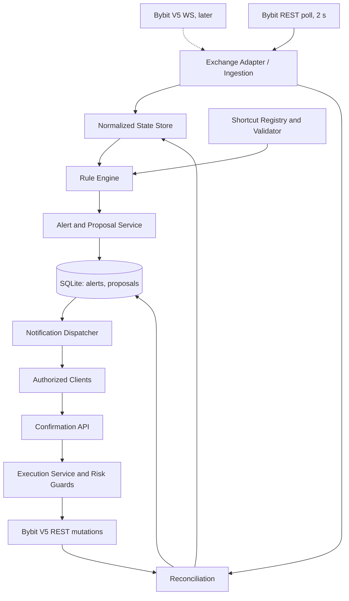

# Trade Shortcuts — Technical Architecture

Implementation reference for the Node server and its browser sandbox counterpart, 25 November 2026. The [rule registry](../server/src/registry.ts), [validator](../server/src/validate.ts) and [HTTP handlers](../server/src/http.ts) define the wire format. The [phone](trade-shortcuts-spec.md) builds rules and the [lens](glasses-shortcuts.md) presents their proposals.

## 1. Product contract

- One shortcut = one scope + one or more conditions + exactly one action with one parameter set.
- Conditions use one group operator (`ALL` / AND or `ANY` / OR). No nesting, mixed precedence, action lists, chains, or arbitrary executable user code.
- Rules generate alerts and action proposals, not automatic trades. Every exchange mutation requires explicit authorization of the exact resolved proposal. `NOTIFY` requires no trade confirmation.
- Seeded shortcuts carry phrases used internally by contextual menu commands. Speech input interprets yes/no answers to the displayed alert. Custom spoken triggers are hidden in the shipped clients.
- Support Bybit USDT-settled linear perpetuals only. Demo/mock first; no implicit live mode, withdrawals, other exchanges, spot, options, inverse or portfolio-margin trading.
- Market alerts work without a position; global position rules evaluate each live position separately. No portfolio-wide or cross-symbol joins.
- Multiple shortcuts may trigger together; group delivery where appropriate but keep each proposal independent. Never execute an entire group.

The current server selects the Bybit adapter only for `EXCHANGE=bybit`. An unset value, `fake`, or any unrecognized value selects the built-in demo. Deployments should set the mode explicitly. Rejecting unknown values at startup is a proposed configuration change. Additional exchange adapters are outside this MVP.

## 2. Architecture and references

Use an event-driven **modular monolith**, not a distributed microservice system. The backend is the authoritative state owner; mobile and Even Hub integrations are replaceable clients.



Reference-driven decisions:

| Reference | Adopt | Do not copy |
|---|---|---|
| Bybit V5 [1–7] | WebSocket events, REST bootstrap/reconciliation, instrument constraints, async order confirmation | Treating a REST acknowledgement as a completed trade |
| TradingView alerts [8] | Explicit crossing vs level predicates, alert frequency and rearming | Full technical indicator engine |
| Coinrule [9] | Condition/action separation and reusable rule definitions | Automatic trade execution |
| json-rules-engine / JsonLogic [10–11] | Declarative `all/any` conditions and evaluation over facts | Arbitrary scripts or generic rule engine as a trading safety layer |
| Azure event-driven architecture [12] | Event producers, consumers, independent responsibilities, idempotency | Separate deployable service per module |

Stack: the existing one. TypeScript run directly by Node ≥ 22.18, no HTTP framework (`server/src/http.ts`), the signed REST client in `server/src/bybit.ts`, REST polling every 2 s (`server/src/main.ts`). One process, one account. Deploy on a persistent host; a request-only serverless function must not own the polling loop or exchange WebSockets. Do not require Redis, Kafka, Kubernetes, PostgreSQL or an LLM.

| Need | MVP choice | Upgrade when |
|---|---|---|
| Durable alerts, proposals | built-in `node:sqlite` (no flag on Node 22.13+, prints an ExperimentalWarning), one file, transactions | several workers or accounts: PostgreSQL with the same tables |
| Mutation serialization | in-process promise chain per account/symbol/positionIdx | several workers: row or advisory locks |
| Private state | REST polling 2 s, fills deduped by `execId` (already done) | fills or crossings arrive too late: private WS via `bybit-api` (`sieblyio/bybit-api`, MIT) `WebsocketClient` only, which handles auth, heartbeats, the 24 h disconnect and resubscribe; keep our REST client |
| Public prices | `/v5/market/tickers` per watched symbol in the same poll | many symbols: public `tickers.{symbol}` WS (Node 22 has a global `WebSocket`) |
| Runtime schemas | shared rule validation in `server/src/validate.ts` | the tagged unions get unwieldy: Zod |
| Money arithmetic | numbers for comparisons; exchange steps kept as strings and quantized by `toStep` (already done); persisted thresholds are decimal strings | a rounding bug shows: decimal.js |
| Alerts on the phone | in-app notifications in the phone app while it is open (it already polls the server) | the phone app becomes native: OS push |
| Speech to text | `server/src/stt.ts` and `POST /api/voice` as today (OpenAI, only when its key is set) | — |

Not reused on purpose: json-rules-engine, JsonLogic, GoRules (no UNKNOWN / NOT_APPLICABLE; the evaluator is a few dozen lines).

## 3. Major modules

| Block | Responsibility | Boundary |
|---|---|---|
| Shortcut Registry | Typed catalog of conditions, actions, scopes, templates, versioned rules | No exchange writes |
| Compatibility Validator | Static matrices, parameter checks, logical consistency, capability constraints | Same implementation for create/update/enable |
| Exchange Adapter | Authentication, REST queries and commands, normalization, rate limits | Only module speaking Bybit wire format |
| State Store | Latest quotes, positions, orders, balance, instruments, rolling windows; freshness and identity | No alert or trade side effects |
| Rule Engine | Resolve targets, select affected rules, evaluate predicates and trigger policy | Pure evaluation + persisted trigger state; never sends orders |
| Alert/Proposal Service | Build one resolved proposal per match, dedupe, expiry, group delivery, priority | Proposals are immutable authorization objects |
| Delivery Adapter | Deliver durable alerts to connected clients, acknowledge, replay and fallback | Never grants execution authority |
| Execution Service | Authorize exact proposal, revalidate, serialize, submit, reconcile, audit | Submits confirmed exchange writes through the adapter |

The [module map](../README.md#how-it-works) identifies the production entry points. The sandbox reuses the HTTP handlers, session and store with browser adapters.

## 4. Canonical rule model

A `ShortcutRule` has an account, immutable version, optional name, enabled state, scope, conditions, trigger, delivery flags and one action. Decimal inputs are strings. Each condition has a stable ID so validation issues and trigger evidence identify the row. The group supports up to ten conditions and one operator, `ALL` or `ANY`.

| Scope | Target identity |
|---|---|
| `ALL_POSITIONS` | Each eligible open position, including future positions |
| `COIN_POSITIONS` | Positions in the selected symbol list, filtered by Any, Long or Short |
| `POSITION` | Symbol, position index and epoch of a particular open position |
| `SYMBOL` | One market, including when the account is flat |
| `ORDER` | One symbol and order ID |
| `ALL_ORDERS` | Eligible orders evaluated separately; fill-driven position actions require a verified mapping |

For example, a position rule can use `NEAR_LIQUIDATION` at 3% and `CLOSE_POSITION` at 50%. A match produces one alert per target. The proposal fixes the rounded quantity for confirmation. Editing, pausing or deleting the rule invalidates pending proposals for the old version.

The server also stores conditionless rules with a unique `voicePhrase`. The contextual menu uses Protect all, Lock profits and Close for guarded proposals. The transcription endpoint returns an answer for the current alert. See the [type definitions and compatibility tables](../server/src/registry.ts).

On opening an existing database, the store removes the retired `SL_MISSING` condition. It deletes a rule left without a condition or phrase, versions surviving rules and leaves an invalid survivor disabled. The store upgrades equivalent legacy actions and preserves their trigger state. Enabled rules with an old time-window price-change condition are paused for review under the new baseline semantics. Historical versions remain available. [Store](../server/src/store.ts) · [Validation](../server/src/validate.ts)

## 5. Condition blocks (13 variants, 7 families)

| ID | Condition | Parameters | Fact / event |
|---|---|---|---|
| C1 | `PRICE` | source, operator (`GTE/LTE/UP_CROSS/DOWN_CROSS`), threshold | Quote / crossing |
| C2 | `PRICE_CHANGE` | source, direction, percent | Base price per rule and target (trigger state) |
| C3 | `PROFIT` | USDT or ROI %, positive magnitude | Position PnL >= N |
| C4 | `LOSS` | USDT or ROI %, positive magnitude | Position PnL <= -N |
| C5 | `NEAR_LIQUIDATION` | distancePct | Mark price, liquidation price |
| C6 | `NEAR_SL` | distancePct | SL price, actual trigger source |
| C7 | `NEAR_TP` | distancePct | TP price, actual trigger source |
| C8 | `ORDER_FILLED` | scope-bound order | Transition into Filled |
| C9 | `ORDER_PARTIAL` | scope-bound order | First partial fill with remaining quantity |
| C10 | `VOLUME_SPIKE` | multiplier (1,100], windowSec 1–60 min | Last-price 1-minute candles, read once a minute |
| C11 | `FUNDING` | ratePct (0,5], minutesBefore 1–480 | Ticker `fundingRate`, `nextFundingTime` |
| C12 | `ORDER_STALE` | minutes 1–10080 | Open order's `createdTime` |
| C13 | `POSITION_CLOSED` | by: `SL` / `TP` / `LIQUIDATION` | Execution `stopOrderType` (StopLoss, PartialStopLoss, TrailingStop / TakeProfit, PartialTakeProfit) or `execType` BustTrade |

Families: Price (C1–2), PnL (C3–4), Liquidation (C5), TP/SL (C6–7), Orders (C8–9, C12), Market (C10–11), Closes (C13).

### Metric definitions

For side sign `d=+1` long / `-1` short, positive relevant price `P`, entry `E`, base quantity `Q`, liquidation `L`, stop `S`, target `T`:
- Price change = `100 * (P_now / P_base - 1)` on the same price source. Default source LastPrice. `P_base` is the first price the rule version sees for the target (switching on or editing makes a new version; a new position is a new target), and moves to the price of each alert, so the next alert needs a new move of N%. It lives in the trigger state, so it survives a restart. A confirm does not recheck it: after the alert the base is the alert's own price.
- Linear unrealized PnL = `d * Q * (P - E)`; prefer authoritative exchange values where fresh and consistent. Mark-price recalculation may be used when verified against Bybit. No mixing of realized PnL or fees.
- ROI = `100 × unrealisedPnl / positionIM` when the denominator is positive. Missing margin yields UNKNOWN. Comparison with the Bybit app for each supported margin mode remains open.
- Liquidation distance = `100 * d * (markPrice - L) / markPrice`. Cross-margin estimate only when valid; portfolio-margin liquidation conditions unsupported. An empty liquidation price from Bybit (cross margin far from liquidation) is a known absence, NOT_APPLICABLE, as Trade Shortcuts treats it today; a stale or unread position is UNKNOWN.
- SL distance = `100 * d * (P - S) / P`; TP distance = `100 * d * (T - P) / P`; use actual order trigger source, not always last price. Resolve from verified order inventory.
- A reached/crossed protective level is not proof of a fill; reconcile position/order state. Do not produce an executable proposal on a closed position.
- Missing/stale/ambiguous data = UNKNOWN. Known absent TP/SL makes corresponding proximity NOT_APPLICABLE. A stop loss counts as absent only when that is verified: the position's `stopLoss` is empty or 0 AND no open order for it has `stopOrderType` `PartialStopLoss` (Partial-mode stops live as orders, not in the position; confirm on Demo how `/v5/order/realtime` lists them). Partial/multiple protection configurations are unsupported for related mutation/proximity logic in MVP: such a position is skipped with the reason in History ("Skipped · partial stop orders on this position").
- Volume spike = average volume per minute of the last `windowSec` of closed 1-minute last-price candles over that of the 60 candles before them. Fewer than 30 base candles, or candles older than 3 minutes, is UNKNOWN. The newest closed candle can lag by up to a minute.
- Funding = the next funding rate in percent. A position counts what it pays (`d * rate`: a long pays a positive rate); One symbol counts either side (`|rate|`). True when the next funding is at most `minutesBefore` away and that is ≥ `ratePct`. Past `nextFundingTime` before the ticker rolls over is UNKNOWN.
- Order age = minutes since `createdTime` of an order still open; a gone order is NOT_APPLICABLE. All orders (scope) is every open non-protective order with remaining qty, plus the ones that filled since (from the recent fills), so a fill and the tap after it still find their order; a fill acts on the position its order opened, as on One order. A market order never shows open, so its fill is not a target.
- Position closed is an edge event of one poll's fresh executions: the position is named by the closing order's slot (or, for a liquidation, the slot that side held) and its epoch before the poll, so it still alerts after the position is gone. Split fills of one closing order alert once (dedupe key `close:<orderId>`). Notify only.
- Each condition type has a fixed severity rank in the registry, used to pick the one reason the lens shows when several OR branches match: `NEAR_LIQUIDATION` > `POSITION_CLOSED` > `LOSS` > `NEAR_SL` > `FUNDING` > `PRICE_CHANGE` > `VOLUME_SPIKE` > `PRICE` > `NEAR_TP` > `PROFIT` > `ORDER_STALE` > `ORDER_PARTIAL` > `ORDER_FILLED`.

## 6. Action blocks (exactly one per shortcut)

| ID | Action | Configured parameters | Exchange command / guards |
|---|---|---|---|
| A1 | `CLOSE_POSITION` | one percentage (0,100] | create-order; opposite side, reduceOnly=true, bound positionIdx, valid qty |
| A2 | `MOVE_SL` | one absolute/entry-relative target or entry price | trading-stop; existing SL, tighten only |
| A3 | `SET_SL` | one absolute or entry-relative target | trading-stop; verified absent SL |
| A4 | `SET_TP` | one absolute or entry-relative target | trading-stop; valid target, preserve SL |
| A5 | `ADD_MARGIN` | one positive USDT amount, or a percent of the position's margin (one shortcut fits every size) | add-margin; supported isolated mode, known margin for a percent, available collateral |
| A6 | `OPEN_LONG` | explicit symbol, 1–5 USDT sizes, 1–5 leverages (default 1, 1.5, 2, 5, 10); optional attached SL/TP | the lens asks the size and leverage when there is more than one (`POST /api/proposals/:id/pick` builds a fresh proposal); set-leverage before create-order; flat symbol, market-only |
| A7 | `OPEN_SHORT` | as A6, sell side | as A6 |
| A8 | `INCREASE_POSITION` | one positive additional USDT notional | create-order; same side/index, existing protection, margin and risk limits |
| A9 | `CANCEL_ORDER` | exact or triggering order ID | cancel; active non-protective order with remaining qty |
| A10 | `NOTIFY` | none | no exchange mutation |

An Open needs a flat symbol. With multiple sizes or leverages, the lens submits a choice to `pick`. The server validates it and replaces the pending proposal once. Confirmation validates the approved quantity against fresh instrument and account constraints. The executor sets the approved leverage before every Open. Bybit's `110043` means the leverage is already set and the order can proceed. A leverage update and the order are separate exchange calls. Increase uses the leverage of an existing protected position and rejects if it changed since the proposal.

Close always uses a reduce-only market order with the authorized quantity. Set SL requires an absent stop, Move SL requires a tighter stop, and Add Margin requires isolated margin and sufficient balance. A percentage margin action resolves against the position’s own margin. The guard can skip a match with a reason in History.

The lens shows each proposal's resolved terms, so a proposal carries them ready to print: Close `percent`, `qty` and coin; stop or target price; Open and Increase `qty`, `notionalUsdt`, `leverage`, estimated margin, attached stop; Add Margin `usdt`.

## 7. Compatibility policy

Single source of truth in the registry. `Y` = allowed with baseline guards; `G` = allowed with extra context; `N` = unsupported MVP policy, not necessarily a Bybit restriction.

| Condition | Close position | Move stop loss | Set stop loss | Set take profit | Add margin | Open long | Open short | Increase position | Cancel order | Notify |
| --- | --- | --- | --- | --- | --- | --- | --- | --- | --- | --- |
| C1 Price | Y | G | G | G | G | G | G | G | G | Y |
| C2 Price change | Y | G | G | G | G | G | G | G | G | Y |
| C3 Profit | Y | G | G | G | G | N | N | G | N | Y |
| C4 Loss | Y | G | G | G | G | N | N | G | N | Y |
| C5 Liquidation distance | Y | G | G | N | G | N | N | N | N | Y |
| C6 Stop loss distance | Y | G | N | N | G | N | N | N | N | Y |
| C7 Take profit distance | Y | G | G | G | G | N | N | N | N | Y |
| C8 Order filled | G | G | G | G | G | N | N | N | N | Y |
| C9 Order partly filled | G | G | G | G | G | N | N | N | Y | Y |
| C10 Volume spike | Y | G | G | G | G | N | N | N | N | Y |
| C11 Funding rate | Y | N | N | N | N | N | N | N | N | Y |
| C12 Order age | N | N | N | N | N | N | N | N | Y | Y |
| C13 Position closed | N | N | N | N | N | N | N | N | N | Y |

All branches, including OR, must be compatible with the action and same bound subject. Position action on price rule requires explicit position binding (global relative-price-change rules bind per position). Order-driven position action requires non-reduce-only opening fill, verified mapping to a currently open position and epoch. Open is symbol-only. Cancel is order-only. Near-liquidation SL proposals require a valid tighter/protective stop between trigger price and liquidation boundary, using verified price-source semantics; otherwise suppress. No risk-increasing action from liquidation, SL/TP proximity, fill events or a volume spike (a spike has no direction). The one exception is Increase on a loss, which averages down: like every Increase it needs a stop on the position and fires Once. Add Margin is separately permitted only by its matrix cells and guards.

### Condition stacking matrix

`B` = AND/OR; `O` = OR only; `A` = AND only; `V` = validate same-metric bounds/duplicates; `-` = disallowed (no common scope, or a close, which leaves no position for another condition to read). Symmetric matrix. Scope and action guards still apply.

| | C1 | C2 | C3 | C4 | C5 | C6 | C7 | C8 | C9 | C10 | C11 | C12 | C13 |
|---|---|---|---|---|---|---|---|---|---|---|---|---|---|
| C1 | V | B | B | B | B | B | B | A | A | B | B | B | - |
| C2 | B | V | B | B | B | B | B | A | A | B | B | B | - |
| C3 | B | B | V | O | B | B | B | - | - | B | B | - | - |
| C4 | B | B | O | V | B | B | B | - | - | B | B | - | - |
| C5 | B | B | B | B | V | B | B | - | - | B | B | - | - |
| C6 | B | B | B | B | B | V | B | - | - | B | B | - | - |
| C7 | B | B | B | B | B | B | V | - | - | B | B | - | - |
| C8 | A | A | - | - | - | - | - | V | O | - | - | - | - |
| C9 | A | A | - | - | - | - | - | O | V | - | - | - | - |
| C10 | B | B | B | B | B | B | B | - | - | V | B | - | - |
| C11 | B | B | B | B | B | B | B | - | - | B | V | - | - |
| C12 | B | B | - | - | - | - | - | - | - | - | - | V | - |
| C13 | - | - | - | - | - | - | - | - | - | - | - | - | V |

Rules beyond the matrix:
- Reject exact duplicates, contradictory ranges, tautologies and redundant same-direction near thresholds. Check the entire group, not only pairs. One consistent source per metric family. No mixed subjects.
- Profit AND Loss are impossible for one position; OR is valid only if action also passes matrix.
- Filled AND Partial is impossible; OR may notify, but cannot Cancel since full-fill branch is incompatible.
- Order event + market state: AND only, market state evaluated at event time. No combination with price crossing or position-state predicates in this order scope MVP.
- Price crossing + state can use AND. Homogeneous crossings can use OR. Reject crossing + level/state OR (avoids ambiguous state/event rearming in MVP). Reject two crossings in AND. This operator-level restriction refines the generic matrix above.
- Max 10 condition items per rule initially. No arbitrary custom operators. `validate(rule, capabilities)` returns structured reason codes; use it on create, update, enable and proposal generation.
- A custom rule to cancel the rest after a partial fill only makes sense for a resting limit order: a market order is filled or IOC-cancelled within milliseconds. `ORDER_PARTIAL` + `CANCEL_ORDER` requires the scoped order to be a non-reduce-only `Limit` order.

`validate()` drives the Incompatible screen, which flags one row and says why ("Liquidation distance is incompatible with Increase Position"). Shape:

```ts
type Issue = { code: string; conditionId?: string; field?: string; message: string }; // message is the UI sentence
type Validation = { ok: boolean; issues: Issue[] };
```

The editor filters choices before the user picks them (phone §7.3: hide static impossibilities, intersect across OR branches). The matrices ship to the phone as data in `GET /catalog`, so the phone filters locally and the server validates again on save; one table, two readers.

## 8. Runtime data and rule engine

A single non-overlapping polling loop builds a snapshot and evaluates enabled rules against their eligible targets. Price crossings require consecutive valid samples. The server deduplicates fills by `execId` and tracks position epochs. A price-change condition keeps a baseline per rule version and target (§5); volume spikes and the Detail chart use candles. Trigger state persists in SQLite. The implementation and timing constants are in [session.ts](../server/src/session.ts).

Evaluation is deterministic and independently unit-testable. `TRUE`, `FALSE`, `UNKNOWN`, `NOT_APPLICABLE` outcomes: ALL is false if a definite false/nonapplicable exists, otherwise unknown if any missing fact, otherwise true. ANY is true if any definite true exists; otherwise unknown if any missing fact; otherwise false. NOT_APPLICABLE never becomes numeric zero. Action guards require fresh authoritative prerequisites even if an unrelated OR branch is true.

Trigger policies (TradingView-inspired):
- `ON_ENTRY`: state group false-to-true; first fresh matching state may emit a single `currently_matches` alert. A definite false rearms; UNKNOWN does not. No fabricated crossing on bootstrap/reconnect. "Definite false" uses hysteresis, as `BAND_PCT` (0.5) does in `server/src/rules.ts` today: a fired threshold rearms only after the value clears it by 0.5 percentage points (distances, ROI) or 0.5% of the level (prices, USDT). Without it a value wobbling on the line fires again after every cooldown.
- `ON_EVENT`: one alert per distinct eligible transition (crossing or fill); event is true only during its evaluation, not forever. Crossing up: prev < threshold and current >= threshold; down mirrored. Never generate executable proposals from old reconciled events.
- `ONCE`: once per rule version and target lifecycle; explicit rearm. Required for Open/Increase in MVP. For event rules, applies as an additional one-shot latch to event semantics, not a different event evaluator.
- `REPEAT`: state-only, configurable interval (default 5 min); no duplicate unresolved proposal. Default cooldown 60 seconds per rule/target for state alerts; use durable rearm state. Distinct real order transitions are not blocked by the state cooldown.

## 9. Alert, proposal and execution lifecycles

A match records the shortcut version, target, reason, matched conditions, priority, time and delivery status. Notify records the alert and, when glasses delivery is on, a card whose only action is OK. A trade match creates a proposal with the resolved terms or records why the action was skipped. The lens confirms a proposal ID with an idempotency key. A simulated test produces a SIMULATED execution.

`PENDING` proposals can become `DISMISSED`, `EXPIRED`, `SUPERSEDED` or `AUTHORIZED`. Execution separately tracks validation, submission, acknowledgement, fills, applied changes, rejection and unknown outcomes. [Record types](../server/src/types.ts)

What the screens need from these records:
- **History** shows one line per alert: action label, time, target and reason ("BTCUSDT long · liquidation distance 3.2%", or "Voice: protect all"), and its last status: `Submitted · waiting for fill`, `Filled · 0.025 BTC at 88,412.0`, `Dismissed on Even G2`, `Expired · not confirmed within 30 s`, `Skipped · partial stop orders on this position`, `Simulation · nothing sent to Bybit`. So an alert records each delivery channel it reached (`glasses`, `app`), a dismissal records where it came from (`glasses` or `app`), and a skip stores its reason code.
- **Lens alert** shows the target, the strongest matching reason (§5 rank) with its observed value, the proposal's resolved terms (§6) and the place in the queue (`1/2`). Queue order: Close, Set/Move stop, Add margin, Cancel (critical first within the group), then Set take profit, then Notify, then Open and Increase; oldest first within a group.
- **Refreshed** (`NEW` on the lens): when step 3 below replaces a proposal, the new one carries `supersedes: <old id>`; a tap that saw the old terms does nothing.
- **Test alert** (`TEST` on the lens, `Simulation` in History): `simulated: true` on the alert and its proposal; confirming it ends in "Test only · nothing was sent", and the execution path stops before the exchange adapter. A test that the adapter can reach is a bug: cover it with a test.
- **Result** reads from executions: filled qty, average price, what is still open ("Still open 0.025 BTC"), or Bybit's reason on a rejection.

Delivery status is distinct from trade status. Repeated delivery uses the same alert/proposal IDs. Proposal expiry and the repeat cooldown are account settings shown in Settings (defaults: market 30 s, protection/margin/cancel 60 s, cooldown 60 s; bounds 10–300 s). Invalidate earlier if rule version, target epoch, protection or order state changes materially or source becomes stale. Alert acknowledgement/dismissal never authorizes a trade. Expiry follows server state. A separate five-second countdown on the lens allows cancellation after a spoken yes.

Simultaneous matches retain separate proposals. Each needs its own confirmation.

### Execution path

1. The lens is the only shipped UI that confirms trades. The API authenticates the shared account bearer token; it does not attest a physical gesture. The client submits `confirm(proposalId, idempotencyKey)` only. Validate ownership, version and expiry; atomically consume the proposal and persist execution intent. Duplicate confirmation returns existing execution status.
2. Within the single server process, serialize conflicting mutations by their execution lane. Fetch fresh state; verify the original rule match for state predicates, valid recent event evidence for edge predicates, and all action guards. A crossing must remain on the triggered side; order events require valid historical evidence and current eligibility. Recheck available balance, account mode, position epoch, quantity, price source, limits and protection. There is no daily loss limit and no per-action cap (decided, §15): the legacy implementation's `dailyLossLimitUsd`, `maxActionUsd` and the lock they drive are removed.
3. If resolved authorization terms changed, invalidate and generate a fresh proposal requiring confirmation. Never silently adjust quantity, target price, margin or leverage. Revalidation cannot remove all exchange races; rely on reduce-only and exchange-side constraints too.
4. Persist intent before sending. Submit one supported exchange command with a stable unique `orderLinkId` where supported. For commands without exchange idempotency, retain local intent and reconcile state before any retry. No blind retries after an ambiguous network outcome. `server/src/bybit.ts` already splits outcomes this way: a non-zero `retCode` is a clear rejection (`ExchangeRejected`), while 10000, 10016, a timeout or a 5xx is UNKNOWN; a rate limit is retried with the same body and `orderLinkId`. Reuse it.
5. REST acknowledgement is not proof of success. The MVP polls REST executions, deduplicates fills by execId and matches orders by orderLinkId. Once 30 s have elapsed, an unresolved order can be looked up directly. Repeated successful lookups that find an unknown order absent can resolve it as rejected. A failed lookup leaves it pending reconciliation. For an unknown SL/TP change compare the position level. For an unknown cancel read the order status. Margin follows the separate rule below. A partial fill is not a full close.
6. Persist the final result; revalidate related proposals. Unknown outcomes block conflicting actions until reconciled. An unknown add margin has no id to reconcile by: it blocks only another add margin and settles when the position closes; a reduce-only Close is never blocked by it.

## 10. Persistence, transport and API contracts

Tables (one SQLite file via `node:sqlite` in the MVP; the same tables move to PostgreSQL when §2 says so):
- `exchange_accounts` holds account metadata. Credentials come from the server environment. `settings` and `meta` hold preferences and seed markers.
- `shortcuts` / `shortcut_versions` — current pointer, immutable rule config.
- `target_state` / `trigger_state` — durable identities, watermarks, last definite verdict, cooldown/once latch.
- `alerts` / `proposals` / `executions` — evidence, authorization, result; unique dedupe and idempotency keys.
- `audit_log` — append-only lifecycle transitions and sanitized error codes.

Hot quote snapshots/rolling history can remain in memory. Persist what is needed for correct deduplication/recovery. One process owns ingestion, evaluation and execution, so a process-local lock per account/symbol/positionIdx is correct; a second worker needs row/advisory locks or leases first. Exchange execution is not guaranteed exactly once.

Endpoints, by the screen that calls them. All under `/api`, behind the existing bearer token (`server/src/http.ts`); every query is scoped to the token's account. Edits carry the version they were made against and fail on a newer one.

| Screen | Call | Returns or does |
|---|---|---|
| Shortcuts | `GET /shortcuts`, `POST /shortcuts/:id/enable`, `/pause` | tiles: derived title (or `name`), When line `summary` ("Liq ≤ 5% or ROI ≤ −20%"), Do line `doSummary` ("Close 50%"), `enabled` |
| Shortcuts · Templates | `GET /templates` | 12 categorized templates with title and When/Do summaries. Opening one on the phone is local. The separate create-by-template API can persist an incomplete disabled draft. |
| New Shortcut, Editor | `GET /catalog` | condition and action registry, editor words, parameter bounds, the three matrices |
| Editor | `POST /shortcuts/validate` | `Validation` (§7) plus, for the numeric sheet and Apply to, the targets it matches now ("3 now") and each condition's current value per target ("Now 18.2% on BTCUSDT long") |
| Editor | `POST /shortcuts`, `PUT /shortcuts/:id`, `DELETE /shortcuts/:id` | save a new version; invalidates outstanding proposals of the old one |
| Editor · Apply to | `GET /positions`, `GET /orders/open`, `GET /symbols` | pickers for One position, One order, One symbol and Positions by coin (several coins and a side) (every USDT perpetual the exchange trades, sorted) |
| Editor · title menu | `POST /shortcuts/:id/test` | a simulated alert and proposal (§9) |
| History | `GET /history?before=` | alert lines with their last status (§9), newest first |
| Settings | `GET /settings`, `PUT /settings` | Bybit status, environment, API access and withdrawals (from `/v5/user/query-api`), live trading (read-only: a server switch, off); Notifications: alerts on glasses, in-app notifications; cooldown and expiry |
| Phone app, any screen | `GET /notifications?after=` | new alerts for the in-app banner and badge, polled while the app is open |
| Lens · voice | `POST /voice` | PCM audio returns `{heard, answer, close}`. `answer` is yes or no for the card. `close` is a whole-phrase close from Speak. The client confirms either and does not parse the transcript. |
| Lens · menu | `POST /command` | `stop`, `lock` or `close` raises guarded proposals. Close can target one position. |
| Lens · Detail | `GET /chart?symbol=…` | Last-price minute candles for an open position; cached for a minute. |
| Lens · Open | `POST /proposals/:id/pick` | Select allowed size and leverage and obtain a new proposal for Review. |
| Lens | `GET /state` (polled, as today) | positions with ROI, liquidation distance, stop/TP, number of enabled shortcuts on each; the proposal queue head with its place; stale-since time |
| Lens | `POST /proposals/:id/confirm`, `/dismiss` | `confirm(proposalId, idempotencyKey)` only; dismiss records the channel |
| Lens | `GET /executions/:id`, `GET /proposals/:id/execution` | Sent → Filled / Partly filled / Rejected / Unknown. The proposal lookup recovers the execution if the confirmation reply was lost. |

The phone page and the lens poll, as Trade Shortcuts does now; push to them (WS or SSE) is not needed for the MVP. Delivery per alert, within `delivery` and the Settings toggles: the lens if the plugin is open (it polled `/state?client=lens` in the last 10 s); an in-app notification if the phone app is open (it polled `/notifications` in the last 10 s). Clients forward user intent and never hold exchange secrets. Rules keep monitoring whether or not any client is open.

## 11. Bybit integration map

The Bybit client uses authenticated REST and accepts the HTTPS demo and testnet hosts. It works with USDT linear perpetuals. The data source in Settings identifies the active mode.

| Purpose | V5 endpoint(s) |
|---|---|
| Positions, margin mode and balance | `/v5/position/list`, `/v5/account/info`, `/v5/account/wallet-balance` |
| Open orders, history and fills | `/v5/order/realtime`, `/v5/order/history`, `/v5/execution/list` |
| Quotes, candles, symbol and instrument constraints | `/v5/market/tickers`, kline endpoints, `/v5/market/instruments-info` |
| Key permissions | `/v5/user/query-api` |
| Order and position changes | `/v5/order/create`, `/v5/order/cancel`, `/v5/position/trading-stop`, `/v5/position/add-margin`, `/v5/position/set-leverage` |

For a hosted paper-only server, `PUBLIC_DEMO=1` requires the fake adapter and disables transcription. The phone’s normal state poll does not mark a lens as present. A connected client with the lens in use sends `GET /state?client=lens`.

The symbol picker pages through tradable USDT perpetuals. The account open-order snapshot currently reads the first page. [Adapter](../server/src/bybit.ts)

## 12. Templates (data only, not separate code paths)

All numerical values are editable examples, not recommended trading thresholds. Templates instantiate disabled drafts and require complete parameters before activation. Each uses the same registry/engine.

The Templates grid on the Shortcuts screen shows them in this order, grouped by category, as logo-and-title tiles (phone spec §4). Tapping a category heading folds or expands its tiles (phone spec §5.1). Retired examples used by the engine suite live on as test fixtures (`server/test/removed-templates.ts`) so the engine tests built on them keep their coverage.

Numbers fit a 5–10× position: breakeven before taking part, add a quarter more margin at 5% from liquidation, close half at 3%. `#` is the template id (`tpl_<#>`), stable across reorders and removals.

| Category | # | Card on the phone (When → Do) | Condition | Action | Scope, trigger |
|---|---|---|---|---|---|
| Protect | 6 | Liq ≤ 3% → Close 50% | Liq distance ≤ 3% | Close 50% | All positions, on entry |
| Protect | 28 | Liq ≤ 5% → Add 25% margin | Liq distance ≤ 5% | Add 25% of the position's own margin (isolated only: a cross position is skipped with the reason) | All positions, on entry |
| Protect | 27 | SL ≤ 1% → Notify me | Stop loss distance ≤ 1% (a position without a stop never fires) | Notify | All positions, on entry |
| Protect | 17 | Closed by stop loss → Notify me | Closed by stop loss | Notify | All positions, on event |
| Take profit | 1 | ROI ≥ 20% → SL to entry | Profit ROI ≥ 20% | Move SL to entry | All positions, on entry |
| Take profit | 2 | ROI ≥ 50% → Close 50% | Profit ROI ≥ 50% | Close 50% | All positions, on entry |
| Market | 10 | Price crosses above … → Notify me | Price crosses a level | Notify | Symbol, on event |
| Market | 26 | Price ±15% → Notify me | Last price up 15% **or** down 15% from the base price (§5) | Notify | All positions (each its own base), on entry |
| Market | 11 | Price −2% → Notify me | Price falls 2% from the base price | Notify | All positions, on entry |
| Market | 20 | Funding ≥ 0.05% in 30 min → Notify me | Pays ≥ 0.05% within 30 min | Notify | All positions, on entry |
| Orders | 14 | Order filled → TP at +3% | Opening order fully filled | Set TP 3% favorable from entry | All orders, the position the filled order opened, on event |
| Orders | 24 | Order open ≥ 1 h → Cancel order | Open ≥ 60 min | Cancel | All orders, on entry |

Two enabled starter rules use `tpl_6` and `tpl_1`. Protect all, Lock profits and Close are separately seeded commands.

## 13. Verification

The server suite covers rule compatibility, per-target price baselines, fills and epochs, option picking, proposal invalidation, concurrent confirmation, exchange ambiguity and reconciliation. The sandbox tests exercise the paper scenarios. See the [handoff](handoff.md) for dated testnet evidence and open device checks, and the [test plan](ui-test-plan.md) for manual acceptance.

## 14. References

Official/primary references consulted for this architecture. Product restrictions, thresholds and deployment choices are our own design decisions.

1. Bybit V5 WebSocket connection: https://bybit-exchange.github.io/docs/v5/ws/connect
2. Bybit public ticker: https://bybit-exchange.github.io/docs/v5/websocket/public/ticker
3. Bybit private position: https://bybit-exchange.github.io/docs/v5/websocket/private/position
4. Bybit private order: https://bybit-exchange.github.io/docs/v5/websocket/private/order
5. Bybit private execution: https://bybit-exchange.github.io/docs/v5/websocket/private/execution
6. Bybit place order: https://bybit-exchange.github.io/docs/v5/order/create-order
7. Bybit Demo Trading: https://bybit-exchange.github.io/docs/v5/demo
8. TradingView alert conditions and frequency: https://www.tradingview.com/support/solutions/43000763312-learn-how-to-configure-alerts/ ; https://www.tradingview.com/support/solutions/43000474415-differences-between-alert-frequencies/
9. Coinrule trigger/action integration: https://help.coinrule.com/articles/120887-how-tradingview-triggers-coinrule-s-actions
10. json-rules-engine rule structure: https://github.com/CacheControl/json-rules-engine/blob/master/docs/rules.md
11. JsonLogic supported operations: https://jsonlogic.com/operations.html
12. Azure event-driven architecture: https://learn.microsoft.com/en-us/azure/architecture/guide/architecture-styles/event-driven
14. Bybit position snapshot: https://bybit-exchange.github.io/docs/v5/position
15. Bybit trading stop: https://bybit-exchange.github.io/docs/v5/position/trading-stop
16. Bybit manual add margin: https://bybit-exchange.github.io/docs/v5/position/manual-add-margin
17. Bybit instrument rules: https://bybit-exchange.github.io/docs/v5/market/instrument
18. Bybit cancel order: https://bybit-exchange.github.io/docs/v5/order/cancel-order
19. Bybit rate limits: https://bybit-exchange.github.io/docs/v5/rate-limit
20. Bybit open orders: https://bybit-exchange.github.io/docs/v5/order/open-order
21. Even Hub networking: https://hub.evenrealities.com/docs/guides/networking
22. Bybit kline: https://bybit-exchange.github.io/docs/v5/market/kline
23. Bybit API key information: https://bybit-exchange.github.io/docs/v5/user/apikey-info
24. bybit-api (Node SDK, MIT): https://github.com/sieblyio/bybit-api
26. Node built-in SQLite: https://nodejs.org/api/sqlite.html

## 15. Product decisions

The exchange adapter accepts Bybit Demo and Testnet. Every trading action needs a proposal confirmation. The app supports adding isolated margin and tightening stops. It offers no fund transfers, daily loss limit or per-action spending cap. The open phone app and G2 display notifications. Only the lens UI offers trade confirmation. Touch and voice flows are documented in the [lens specification](glasses-shortcuts.md).
