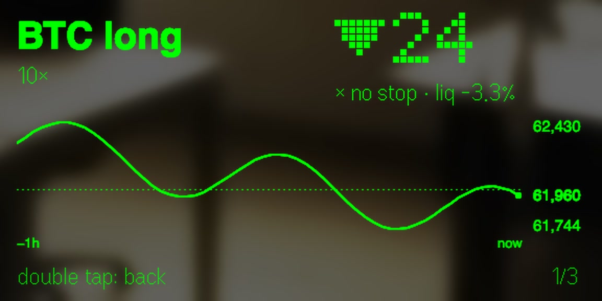
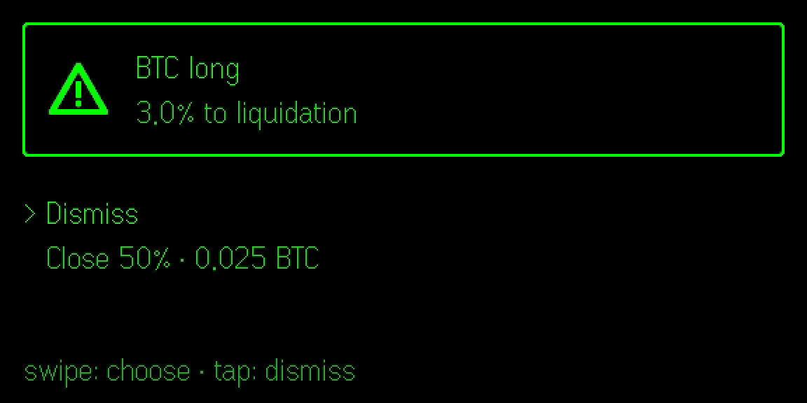

# Trade Shortcuts on Even Hub

**Bybit alerts and confirmations on G2**

| Listing field | Value |
| --- | --- |
| Name | Trade Shortcuts |
| Package ID | `com.tradeshortcuts.g2` |
| Version | 0.1.5 |
| Language | English |
| Suggested tags | Trading, Bybit, Alerts |

| Material | Link |
| --- | --- |
| Interactive demo | [Paper BTC liquidation scenario](https://trade-shortcuts-pi.vercel.app/sandbox/#liquidation) |
| Physical G2 | [Beta installation and testing](judge-testing.md) |
| Project site | [Trade Shortcuts](https://trade-shortcuts-pi.vercel.app/) |

## About this plugin

When a price reaches your target or a position gets close to liquidation, see the alert on your Even G2. Set the rule on your phone and choose how to respond on the glasses.

**Build a shortcut.** Pick a template or create your own rule. Get a price alert, set a stop loss or prepare to close part of a position.

**Check your positions.** Swipe through open positions on G2 to see the price, profit or loss, and distance to liquidation.

**Review and respond.** See why the rule fired and the exact quantity or price of the proposed order. Swipe to choose and tap to confirm or dismiss. The result appears on G2 and in phone History.

**Get started.** Try the paper scenario in your browser or connect the plugin to a Trade Shortcuts server with a paper account, Bybit Demo Trading or Bybit Testnet. Alerts appear while the plugin is open on G2. Optional voice replies require server transcription.

## What’s new in 0.1.5

Improved recognition of spoken close requests from the position screen. Choose **Speak** and say “close” to open a proposal with **Dismiss** selected.

## Assets and permissions

- [24 × 24 monochrome icon](../assets/even-hub-icon.png) and [grayscale cover](../assets/even-hub-cover.png).
- [Privacy policy](https://trade-shortcuts-pi.vercel.app/privacy.html) covers the server connection, local settings, account history, and optional G2 microphone and transcription. The two requested permissions are declared in [app.json](../app/app.json).

## Reviewer walkthrough

Use the [paper walkthrough](judge-testing.md#even-hub-beta). Provide the reviewer with access to the paper backend through an approved private channel. Check that the installed build is the intended version and that the account shows **Paper** or **Demo data** before confirming an action.

On G2 with the phone locked, verify launch from the glasses menu, the connection test, a paper alert and confirmation, and the result on G2 and in History. Leave the phone locked for five minutes and check that the lens still responds. Double tap on the root screen, confirm the system exit, and launch Conversate without restarting the glasses. Test interrupted voice separately against a paper server with transcription enabled.

Record the app and phone versions, G2 firmware, input device, and results before submitting a version for public review. [Even Hub QA guidelines](https://hub.evenrealities.com/docs/ship/app-submission)

## App screenshots

### Simulated G2

**Position detail**

**Liquidation alert**

**Paper fill**

### Phone companion

| Shortcuts | Rule editor | History |
| --- | --- | --- |
|  |  |  |
